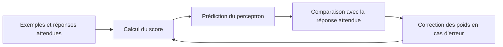

# TP 1 — Comprendre le perceptron

> [!info] Documents du TP
> - [[TP perceptron Kontzler Clément.pdf|Compte rendu de Clément en PDF]]
> - [[TP perceptron Kontzler Clément.docx|Compte rendu de Clément en Word]]
> - [[TP perceptron.pdf|Autre version en PDF]]
> - [[TP perceptron.docx|Autre version en Word]]
>
> Les deux PDF contiennent des comptes rendus de résultats très proches. Ils ne présentent pas un énoncé séparé. Cette note explique ce qui est visible dans les documents.

## 1. À quoi sert ce TP ?

Le TP étudie comment un **perceptron** apprend à séparer des exemples en deux catégories. Il compare deux façons de mettre à jour les poids, puis observe comment le nombre de variables et d'exemples influence les résultats.

> [!tip] L'idée avec Sly Cooper
> Imagine que Sly veut reconnaître si un passage est sûr. Il observe plusieurs indices, comme la présence de gardes et de caméras. Le perceptron combine ces indices et donne une réponse. Pendant l'apprentissage, il ajuste l'importance de chaque indice à partir d'exemples déjà étiquetés.

## 2. Les symboles à connaître

| Symbole | Signification |
| --- | --- |
| $N$ | Nombre de coordonnées d'entrée, sans compter le biais |
| $P$ | Nombre d'exemples appelés aussi patrons ou points |
| $x$ | Vecteur des entrées d'un exemple |
| $x_0=1$ | Entrée ajoutée pour intégrer le biais |
| $W=(w_0,w_1,\ldots,w_N)$ | Poids du perceptron, biais compris |
| $W^*$ | Poids du perceptron professeur |
| $\eta$ | Taux d'apprentissage qui règle la taille des corrections |
| $IT$ | Nombre de passages complets sur les données, dernier passage sans erreur compris dans le compte rendu |
| $R$ | Cosinus entre les vecteurs de poids de l'élève et du professeur |

Le score est le produit scalaire des poids par les entrées. L'entrée constante $x_0=1$ permet d'ajouter le biais $w_0$ :

$$
h=W\cdot x=w_0+\sum_{i=1}^{N}w_ix_i.
$$

La classe prédite dépend du signe du score. Dans le cours, le score nul est associé à $+1$. Pour reproduire exactement un programme, il faut garder sa propre convention au point zéro et son codage des classes.

## 3. Une correction pas à pas

Une règle courante pour des classes $-1$ et $+1$ consiste, lorsqu'un exemple est mal classé, à appliquer :

$$
W_{\mathrm{nouveau}}=W_{\mathrm{ancien}}+\eta\tau x.
$$

Ici $\tau$ est la classe attendue et $x$ comprend la coordonnée du biais. Le compte rendu décrit l'ajustement des poids, sans fournir le code détaillé. Cette formule est donc un **exemple pédagogique de règle**, pas une affirmation sur chaque détail de son implémentation.

> [!example] Exemple calculé
> On prend $W=(0,0,0)$, $x=(1,1,-1)$, $\tau=-1$ et $\eta=0{,}1$. Avec la convention $\operatorname{signe}(0)=+1$, le modèle prédit $+1$ alors que la réponse attendue est $-1$.
>
> $$
> W_{\mathrm{nouveau}}=(0,0,0)+0{,}1(-1)(1,1,-1)=(-0{,}1,-0{,}1,0{,}1).
> $$
>
> Le nouveau score sur le même exemple vaut $-0{,}1-0{,}1-0{,}1=-0{,}3$. La prédiction devient $-1$.

## 4. Batch et online

| Version | Moment où les poids changent | Conséquence pratique |
| --- | --- | --- |
| Online | Après chaque erreur | L'exemple suivant utilise immédiatement les nouveaux poids |
| Batch | Après un passage complet | Les corrections calculées pendant le passage sont accumulées avant la mise à jour |

Un passage complet sur tous les exemples est une **époque**. Si trois passages avec corrections sont suivis d'un passage entier sans erreur, le compte rendu comptabilise $IT=4$.

> [!warning] Ne pas confondre
> $IT$ compte ici les passages complets, pas le nombre d'erreurs ni le nombre de points. Un passage sur 1 000 points demande généralement plus de travail qu'un passage sur 10 points.

## 5. Premiers tests : ET, OU et quatre points du cours

Le compte rendu indique qu'avec $\eta=0{,}1$, les deux versions classent correctement les quatre points de chaque ensemble testé.

| Ensemble | Batch, passages | Online, passages | Réussite indiquée |
| --- | ---: | ---: | --- |
| ET | 4 | 4 | 4 points sur 4 |
| OU | 6 | 5 | 4 points sur 4 |
| Quatre points du cours | 3 | 2 | 4 points sur 4 |

Les poids obtenus peuvent être différents tout en classant correctement les mêmes exemples. Plusieurs droites peuvent en effet séparer deux petits groupes de points. Une bonne classification du jeu d'entraînement n'impose donc pas un unique vecteur de poids.

## 6. Professeur et élèves

L'expérience suivante utilise un perceptron **professeur** dont les poids sont tirés, puis des points sont étiquetés à partir du signe de son score. Les perceptrons **élèves** apprennent à partir de ces exemples.

Pour chaque couple $(N,P)$, le compte rendu annonce 100 tirages et 20 élèves par tirage. Les élèves sont entraînés avec des threads. Le document donne leurs résultats et non le programme utilisé.

Dans un exemple avec $N=2$, $P=10$ et $\eta=0{,}1$, les poids du professeur sont :

$$
W^*=(0{,}647,-0{,}557,-1{,}236).
$$

Les 20 élèves de l'exemple batch classent les 10 points, malgré des poids finaux différents. Le rapport présente également une comparaison online sur le même tirage et avec les mêmes poids initiaux.

## 7. Comment comprendre $R$ ?

Pour deux vecteurs non nuls :

$$
R=\frac{W\cdot W^*}{\lVert W\rVert\lVert W^*\rVert}.
$$

- $R$ proche de $1$ signifie que les vecteurs pointent dans des directions proches
- $R$ proche de $0$ signifie que leurs directions sont presque perpendiculaires
- $R$ proche de $-1$ signifie que leurs directions sont opposées

> [!example] Petit calcul
> Si $W=(2,0)$ et $W^*=(5,0)$, alors $R=10/(2\times5)=1$. Les poids ne sont pas identiques, mais ils ont la même direction.

> [!warning] Ce que $R$ ne dit pas à lui seul
> Le cosinus compare les directions des poids, y compris le biais si celui-ci est intégré au vecteur utilisé. Il n'est pas directement le taux de bonnes prédictions sur des données nouvelles. Pour mesurer la généralisation, il faut aussi évaluer des exemples de test indépendants.

## 8. Lire une case du tableau

Dans les grands tableaux, une case donne d'abord la moyenne de $IT$, puis la moyenne de $R$. Par exemple, pour le batch avec $\eta=0{,}1$, $N=100$ et $P=500$, le rapport donne :

$$
IT_{\text{moyen}}=8{,}0
\qquad
R_{\text{moyen}}=0{,}930.
$$

Cela signifie environ huit passages complets en moyenne et un vecteur de poids généralement orienté dans une direction proche de celle du professeur. Ce sont des moyennes sur les essais rapportés, pas une garantie pour chaque élève.

## 9. Que montrent les résultats ?

Pour $\eta=0{,}1$ et $N=100$ en batch, le rapport indique $R=0{,}249$ pour $P=10$, puis $R=0{,}962$ pour $P=1\,000$. Dans ces essais, davantage d'exemples aident donc à retrouver la direction du professeur.

À $P=1\,000$ en batch, le rapport indique $R=0{,}992$ pour $N=2$ et $R=0{,}363$ pour $N=5\,000$. À nombre d'exemples fixé, les cas de grande dimension donnent ici une direction moins proche de celle du professeur.

Pour $N=100$ et $P=1\,000$, les valeurs moyennes de $IT$ à $\eta=0{,}1$ sont $8{,}3$ en batch et $16{,}3$ en online. Pour $N=2$ et $P=1\,000$, elles sont $9{,}0$ et $2{,}2$. L'une ou l'autre méthode peut donc demander moins de passages selon le cas. Le temps d'exécution ne se déduit pas uniquement de $IT$.

Le rapport compare aussi $\eta=0{,}1$, $0{,}05$ et $0{,}01$. Les résultats changent peu dans beaucoup des essais présentés, avec quelques différences notamment pour de petits jeux. Ce constat dépend de l'expérience et ne signifie pas que le choix de $\eta$ est toujours sans effet.

> [!important] Limites de l'expérience
> Le rapport précise que les jeux à une seule classe et les points de marge normalisée inférieure à $0{,}2$ ont été écartés. Les conclusions concernent ces données filtrées. Les durées dépendent aussi de l'exécution et des threads.

## 10. Questions pour t'entraîner

1. Si $N=10$, combien de coordonnées comprend le vecteur d'entrée avec le biais ?
2. Si les poids sont modifiés après chaque erreur, quelle version est utilisée ?
3. Un élève classe tous les points d'entraînement correctement. A-t-il nécessairement les mêmes poids que le professeur ?
4. Que signifie un $R$ proche de $1$ ?
5. Pourquoi faut-il un jeu de test indépendant ?

> [!success]- Réponses
> 1. Il y a 11 coordonnées, car $x_0=1$ s'ajoute aux 10 entrées.
> 2. La version online.
> 3. Non. Plusieurs vecteurs peuvent classer correctement les mêmes points.
> 4. Les vecteurs de poids ont des directions proches.
> 5. Pour estimer la qualité des prédictions sur des exemples qui n'ont pas servi à l'apprentissage.
