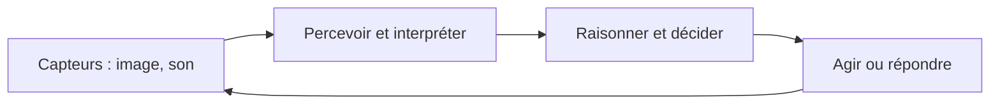

# 👁️ 2. Fonctions cognitives et applications

[[CH1-Introduction-a-l-IA|⬅ Sommaire]] · [[01-Reperes-histoire-et-enjeux|Chapitre précédent]] · [[03-Paradigmes-de-l-IA|Chapitre suivant ➡]] · [[04-Revision-et-QCM|📝 QCM]]

> [!abstract] L’idée générale
> Le cours rapproche certaines tâches de l’IA des fonctions cognitives humaines. Une application combine souvent perception, interprétation et décision. Une ressemblance de fonction ne prouve pas que l’ordinateur travaille comme le cerveau.

## 1. Les fonctions cognitives

Le support cite les fonctions suivantes. Chez l’être humain, elles sont en interaction et mobilisent des régions cérébrales connectées.

| Fonction | En termes simples | Exemple inspiré de l’IA |
|---|---|---|
| Perception visuelle | Traiter et interpréter ce que l’on voit | Détecter un obstacle sur une image |
| Langage ou phasie | Comprendre et produire du langage | Transcrire une phrase prononcée |
| Attention | Sélectionner les informations pertinentes | Repérer un élément important dans une scène |
| Mémoire | Conserver et utiliser des informations | Retrouver des informations déjà enregistrées |
| Raisonnement et fonctions exécutives | Comparer, planifier et choisir | Calculer un itinéraire |
| Émotion | Ressentir et exprimer des émotions chez l’humain | Analyser des indices émotionnels, avec des limites |
| Motricité ou praxie | Réaliser et organiser des gestes | Commander les mouvements d’un robot |

> [!example] La mission de Sly
> Sly observe un garde, se rappelle la carte, comprend les instructions de Bentley, choisit un trajet et saute par-dessus un obstacle. Ces étapes font intervenir plusieurs fonctions qui coopèrent.

## 2. Un domaine aux nombreuses branches

Les schémas de classification du support mettent en relation plusieurs domaines :

- représentation des connaissances et raisonnement
- apprentissage automatique et analyse de données
- vision et reconnaissance de formes
- traitement automatique des langues
- robotique et systèmes multi-agents
- planification, aide à la décision et optimisation
- interaction humain-machine et sciences cognitives
- éthique, droit et sciences humaines et sociales

Ces catégories se croisent. Un robot peut par exemple employer la vision pour percevoir, la planification pour choisir son trajet et un modèle de langage pour interagir.

## 3. Vision et reconnaissance d’images

La vision par ordinateur vise à extraire des informations des images et des vidéos. Une tâche peut consister à **classer** une image, à **détecter** des objets ou à suivre un objet au fil des images. Le support mentionne notamment l’écriture manuscrite, la lecture sur les lèvres, la sécurité et les véhicules autonomes.

> [!example] Exemple inventé
> Une caméra transmet une image à un modèle qui repère un garde. Un autre composant décide ensuite si une alarme doit être déclenchée. La détection et la décision sont deux étapes différentes.

Les erreurs varient selon l’éclairage, la qualité de l’image, les situations observées et les personnes représentées. Une prédiction ne constitue pas automatiquement une preuve certaine.

## 4. Traitement du langage et de la parole

Le traitement automatique du langage comprend l’analyse et la production de textes, la traduction, les agents conversationnels et l’analyse sémantique. Pour la parole, on distingue :

1. **Reconnaissance vocale** : transformer un signal sonore en texte.
2. **Traitement du langage** : analyser ou produire du contenu linguistique.
3. **Synthèse vocale** : produire une voix à partir d’un texte ou d’une représentation.

Le support souligne les difficultés de compréhension, de gestion des interactions et de génération. Un résultat plausible peut être erroné.

## 5. Analyse prédictive et recommandation

L’analyse prédictive exploite des données et des méthodes statistiques pour estimer une valeur, une catégorie ou un événement futur. Elle peut servir à recommander des contenus, estimer une demande ou aider à analyser un risque.

> [!warning] Prédiction ≠ certitude
> Une prédiction dépend des données, du contexte et du modèle. Une relation statistique ne prouve pas nécessairement une relation de cause à effet.

### Détection d’informations trompeuses

Le support décrit des systèmes qui repèrent des caractéristiques dans des textes annotés. Un détecteur peut exploiter certains mots ou certains styles, mais cela ne permet pas à lui seul de vérifier la vérité objective de chaque affirmation. La vérification demande aussi un examen du contexte et des sources.

### Justice prédictive

Le support cite COMPAS et HART comme exemples d’outils d’évaluation de risques. Il invite à examiner les biais et les conséquences d’une utilisation dans des décisions humaines. Une estimation de risque ne détermine pas avec certitude le comportement d’une personne.

## 6. Robotique et véhicules autonomes

La robotique humanoïde associe plusieurs disciplines, notamment mécanique, électronique, commande, perception et IA. Un robot peut chercher à percevoir son environnement, planifier ses actions et interagir avec des humains. Le support mentionne Pepper et les travaux de Boston Dynamics et d’Ishiguro.

Pour un véhicule, le cours distingue notamment la **perception** de l’environnement, la **localisation** et la **décision**. Il illustre des niveaux d’automatisation de 0 à 5. Dans cette classification, les niveaux 1 et 2 correspondent à des aides à la conduite sous surveillance humaine. Le niveau 3 est conditionnel et nécessite une reprise humaine dans certaines situations. Le niveau 4 fonctionne de manière autonome dans un domaine de fonctionnement défini. Le niveau 5 vise toutes les conditions de conduite prises en charge par le système.

> [!important] À retenir
> Un véhicule autonome n’est pas forcément autonome partout et tout le temps. Il faut regarder son niveau et ses conditions de fonctionnement.

## 7. Santé, recherche et art

- **Santé** : aide à l’analyse, au diagnostic, à la recherche documentaire et à l’étude de données biologiques. La fiabilité, la protection des données et la responsabilité sont essentielles.
- **Art** : génération ou transformation d’images, de musique ou de textes à partir d’exemples, de modèles ou de règles. Le support interroge notamment la création, l’inspiration et le plagiat.
- **Simulation et jeux** : exploration de stratégies et étude de systèmes complexes.

## ✅ À retenir

1. Les fonctions cognitives sont liées les unes aux autres.
2. La vision, le langage, la robotique et l’apprentissage peuvent être combinés.
3. Une prédiction ou une détection peut être utile tout en restant incertaine.
4. Un niveau d’autonomie doit toujours être compris dans son domaine d’utilisation.
