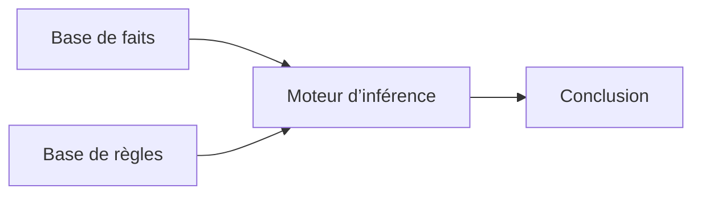

# 🧩 3. Paradigmes de l’IA

[[CH1-Introduction-a-l-IA|⬅ Sommaire]] · [[02-Fonctions-cognitives-et-applications|Chapitre précédent]] · [[04-Revision-et-QCM|📝 QCM]]

> [!abstract] L’idée générale
> Un paradigme est une manière d’aborder un problème. On peut représenter explicitement des connaissances avec des symboles et des règles, ou ajuster un modèle à partir de données. Ces approches peuvent aussi être combinées.

## 1. Plusieurs familles de méthodes

Le support cite une classification de Pedro Domingos en cinq « tribus » :

| Famille | Source d’inspiration | Idée associée dans le support |
|---|---|---|
| Symbolistes | Logique et philosophie | Déduction et manipulation de symboles |
| Connexionnistes | Neurosciences | Réseaux de neurones et rétropropagation |
| Évolutionnistes | Évolution biologique | Algorithmes génétiques |
| Bayésiens | Statistiques | Inférence probabiliste |
| Analogistes | Psychologie | Ressemblance et méthodes à noyau |

Cette classification aide à se repérer. Elle ne signifie pas que chaque système appartient à une seule famille sans chevauchement.

## 2. IA symbolique

L’**IA symbolique** représente explicitement des objets, des faits et des règles, puis les manipule pour raisonner. Le support parle d’une approche « descendante » ou *top-down*. Parmi ses repères historiques figurent les travaux de Boole, le *General Problem Solver* de Newell et Simon, LISP et la programmation logique.

### Logique propositionnelle

Une **proposition** est un énoncé auquel on attribue une valeur de vérité, vraie ou fausse. On peut construire des propositions composées avec des connecteurs.

| Notation | Lecture | Condition de vérité |
|---|---|---|
| $\neg P$ | Non P | P est fausse |
| $P \land Q$ | P et Q | P et Q sont toutes les deux vraies |
| $P \lor Q$ | P ou Q | Au moins une des deux est vraie |
| $P \Rightarrow Q$ | Si P alors Q | Fausse uniquement lorsque P est vraie et Q est fausse |

> [!example] Exemple inventé avec Bentley
> P = « la clé est présente ». Q = « le code est correct ». La règle « si P et Q, alors la porte peut s’ouvrir » se note $(P \land Q) \Rightarrow O$.

Attention, une implication $P \Rightarrow Q$ et le fait Q ne permettent pas à eux seuls de conclure P. La porte peut s’ouvrir pour une autre raison.

### Logique du premier ordre

Elle enrichit la logique propositionnelle avec des objets, des variables, des prédicats, des fonctions et des quantificateurs. Elle permet d’exprimer des relations générales.

- $Garde(x)$ signifie que l’objet $x$ est un garde.
- $\forall x$ signifie « pour tout x ».
- $\exists x$ signifie « il existe au moins un x ».
- Exemple : $\forall x\,(Garde(x) \Rightarrow Personnage(x))$ signifie que tout garde est un personnage.

Le support indique que la logique du premier ordre est complète et semi-décidable. Cela ne veut pas dire que tous les problèmes de vérité peuvent être résolus en temps fini par une procédure générale.

## 3. Systèmes experts

Un système expert utilise des connaissances codifiées dans un domaine spécialisé.

> [!example] Exemple inventé
> Fait : « une caméra est active ». Règle : « si une caméra est active et que Sly passe devant, une alerte est déclenchée ». Si les deux faits sont établis, le moteur peut déduire l’alerte.

La qualité dépend des faits et des règles disponibles. Un tel système ne couvre pas automatiquement les situations absentes de sa base. Le support cite notamment DENDRAL et MYCIN.

### Logique floue

La logique floue, associée à Lotfi Zadeh, permet de représenter des degrés d’appartenance entre 0 et 1. Par exemple, 0,7 peut indiquer à quel point une température appartient à la catégorie « chaud » selon une fonction choisie.

> [!warning] Flou et probabilité
> Un degré d’appartenance à une catégorie graduelle ne correspond pas automatiquement à la probabilité qu’une proposition soit vraie. Ce sont deux façons différentes de représenter l’information.

## 4. Apprentissage automatique

L’apprentissage automatique cherche à ajuster un modèle à partir de données ou d’expériences. Les personnes choisissent encore l’objectif, les données, la méthode et l’évaluation. « Apprendre sans programmer chaque règle » ne signifie donc pas « sans aucune intervention humaine ».

Une entrée peut être un nombre, une image, du son ou un texte, mais ces objets doivent être représentés numériquement pour être traités par l’ordinateur.

### Les trois grands types

| Type | Informations disponibles | Objectif | Exemple inventé |
|---|---|---|---|
| Supervisé | Exemples associés à une réponse cible | Prédire la réponse d’un nouvel exemple | Photos étiquetées « garde » ou « ami » |
| Non supervisé | Données sans réponse cible fournie pour la tâche | Découvrir une structure | Regrouper des images similaires sans étiquette de groupe |
| Renforcement | Un agent agit et reçoit un retour de l’environnement | Apprendre une stratégie maximisant une récompense cumulée | Apprendre un trajet avec récompenses et pénalités |

> [!example] Sly et les trois apprentissages
> Bentley montre des images déjà classées : c’est supervisé. Il cherche des groupes d’images sans nom connu : c’est non supervisé. Sly apprend par essais et retours à atteindre un objectif : c’est du renforcement.

### Classification et régression

- **Classification** : prédire une catégorie, par exemple « garde » ou « ami ».
- **Régression** : prédire une valeur numérique, par exemple le temps nécessaire pour atteindre une porte.
- **Clustering**, ou regroupement : former des groupes selon des ressemblances sans classe cible fournie.
- **Réduction de dimension** : représenter les données avec moins de variables pour les étudier ou les visualiser, en cherchant à conserver certaines propriétés utiles.

## 5. Exemples de méthodes supervisées

### Les k plus proches voisins

Pour classer une nouvelle observation, on repère les **k exemples d’entraînement les plus proches** selon une distance choisie. En classification, on peut prendre la classe majoritaire parmi ces voisins.

> [!example] Exemple
> Pour $k=5$, les cinq voisins d’une nouvelle image comprennent trois gardes et deux amis. Un vote majoritaire classe l’image comme « garde ». Le résultat dépend notamment de $k$, de la distance et de la représentation des données.

### Machines à vecteurs de support ou SVM

Un SVM de classification cherche une frontière séparant les classes en privilégiant une marge. Les **vecteurs de support** sont les observations qui jouent un rôle déterminant dans cette frontière. Lorsque les données ne sont pas séparables par une droite dans l’espace initial, certains noyaux permettent d’exprimer une séparation non linéaire sans calculer explicitement toutes les coordonnées dans un espace transformé.

### Discriminatif et génératif

Un modèle **discriminatif** cherche directement à distinguer les classes ou à estimer une classe à partir des caractéristiques. Une approche **générative**, au sens du schéma du cours, modélise la distribution des données ou leur distribution par classe. Le terme « IA générative » est aussi employé pour désigner des systèmes capables de produire de nouveaux contenus.

## 6. Évaluer un modèle

Il faut distinguer les données utilisées pour apprendre et celles utilisées pour vérifier les performances sur des cas non vus. L’évaluation doit correspondre aux conditions d’utilisation envisagées et examiner aussi les erreurs par groupe ou situation.

Le **sous-apprentissage** survient lorsqu’un modèle est trop limité pour saisir les régularités pertinentes. Le **surapprentissage** apparaît lorsqu’il s’ajuste trop aux particularités des données d’entraînement et généralise mal. Le compromis biais-variance décrit une tension statistique entre erreur due à des hypothèses trop rigides et sensibilité aux variations des données d’entraînement.

> [!important] Piège de QCM
> Un excellent résultat sur les seules données d’entraînement ne prouve pas que le modèle fonctionnera correctement sur de nouvelles données.

## ✅ À retenir

1. Une règle logique explicite et un modèle appris sont deux approches différentes qui peuvent coexister.
2. Supervisé = cibles connues, non supervisé = structure sans cibles, renforcement = actions et récompenses.
3. Classification = catégorie, régression = valeur numérique.
4. Les k plus proches voisins utilisent la proximité. Les SVM exploitent une frontière et une marge.
5. Il faut évaluer la généralisation et comprendre les limites du modèle.
