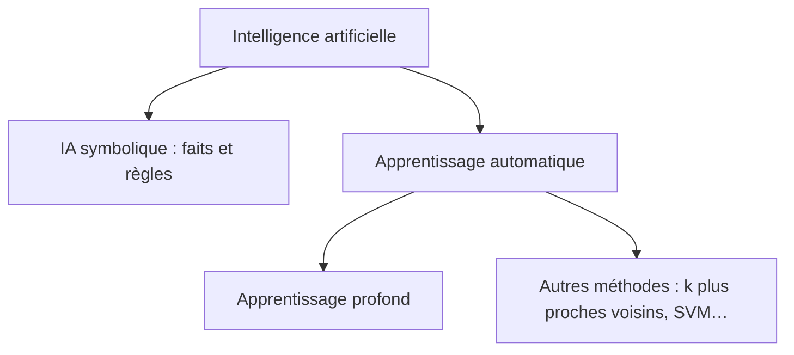

# 🧠 Introduction à l’intelligence artificielle

> [!abstract] Le point de départ de la matière
> Cette matière présente l’ensemble du domaine de l’IA. L’apprentissage supervisé est une matière distincte qui approfondit une famille de méthodes.

## 🗺️ Sommaire

1. [[01-Reperes-histoire-et-enjeux|Repères, histoire et enjeux]]
2. [[02-Fonctions-cognitives-et-applications|Fonctions cognitives et applications]]
3. [[03-Paradigmes-de-l-IA|Paradigmes de l’IA]]
4. [[04-Revision-et-QCM|Fiche de révision et QCM corrigé]]

## ⚡ Le cours en une minute

L’**intelligence artificielle** est un vaste domaine de l’informatique qui étudie et construit des systèmes capables d’effectuer des tâches associées à des facultés comme percevoir, raisonner, apprendre ou utiliser le langage.

L’**apprentissage automatique**, ou machine learning, est une partie de l’IA. Un système y ajuste un modèle à partir de données ou d’expériences. L’**apprentissage profond**, ou deep learning, est une famille d’approches du machine learning utilisant des réseaux de neurones à plusieurs couches.

> [!example] Exemple inventé avec Sly Cooper
> Une alarme qui sonne chaque jour à 20 h est une automatisation. Un programme qui apprend à reconnaître les gardes sur des images utilise de l’apprentissage automatique. Un système qui applique les règles écrites par Bentley illustre l’IA symbolique.

## 📝 Évaluation indiquée sur Moodle

La page du module annonce **40 % pour le compte rendu et l’exposé du TP1**, **40 % pour un examen écrit de type QCM** et **20 % pour le rendu du TP2**. Le QCM porte sur le cours et les sujets de TP. Vérifie les échéances et modalités actualisées sur Moodle.

> [!warning] TP à compléter
> Lors de la consultation, la rubrique « Travaux pratiques » ne contenait pas de sujets accessibles. Le programme mentionne une recherche documentaire sur un domaine de l’IA et une prise en main d’API d’IA. Les sujets précis restent à ajouter dès qu’ils seront disponibles.

## 🔗 Sources et méthode

- [Page Moodle du cours](https://e-uapv2026.univ-avignon.fr/course/view.php?id=887)
- [Dossier des trois supports PDF](https://e-uapv2026.univ-avignon.fr/mod/folder/view.php?id=7895)
- Supports « Introduction à l’intelligence artificielle », Fabrice Lefèvre, CERI, 2026. L’accès nécessite la connexion universitaire.
- Les notes reformulent et expliquent les supports disponibles. Les exemples avec Sly Cooper et les QCM ont été créés pour aider à comprendre, ce ne sont pas les questions officielles.
- Les supports contiennent de nombreuses illustrations. Les notes expliquent leurs idées principales sans prétendre remplacer chaque détail visuel des diapositives.
