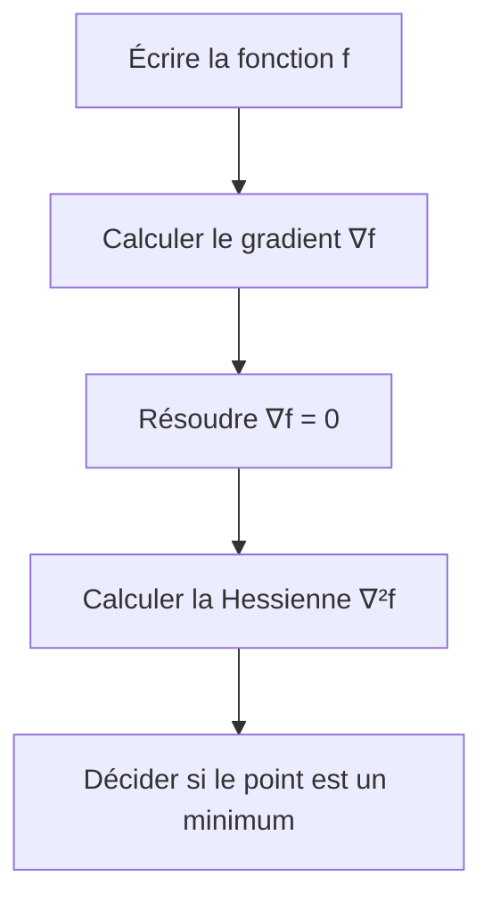

![[IMG_7430.jpeg]]

![[IMG_7432.jpeg]]

![[IMG_7433.jpeg]]

![[IMG_7434.jpeg]]

![[IMG_7435.jpeg]]

![[IMG_7436.jpeg]]

![[IMG_7438.jpeg]]

![[IMG_7439.jpeg]]

![[IMG_7440.jpeg]]

![[IMG_7441.jpeg]]

![[IMG_7443.jpeg]]

![[IMG_7444.jpeg]]

![[IMG_7445.jpeg]]

![[IMG_7446.jpeg]]

![[IMG_7447.jpeg]]

![[IMG_7448.jpeg]]

![[IMG_7449.jpeg]]

![[IMG_7450.jpeg]]

![[IMG_7451.jpeg]]

![[IMG_7452.jpeg]]

![[IMG_7454.jpeg]]

![[IMG_7456.jpeg]]

![[IMG_7457.jpeg]]

![[IMG_7458.jpeg]]

![[IMG_7460.jpeg]]

![[IMG_7461.jpeg]]

![[IMG_7462.jpeg]]

![[IMG_7463.jpeg]]

![[IMG_7464.jpeg]]# Exercices et exemples — Optimisation non linéaire

> [!abstract] À quoi sert cette note
> Cette fiche accompagne [[00-Optimisation-non-lineaire]]. Elle reprend la même méthode sur des exemples très simples avant de revenir aux exercices du cours.

## La méthode à suivre à chaque fois

> [!tip] Réflexe à avoir
> Un gradient nul signifie seulement que le point est un **candidat**. Il faut encore étudier la Hessienne ou le comportement de la fonction.

## Exemple 1 — Une variable, pas à pas

On cherche le minimum de :

$$
f(x) = x^2 - 6x + 13.
$$

### Étape 1 — Calculer la dérivée

$$
f'(x) = 2x - 6.
$$

### Étape 2 — Chercher le point stationnaire

$$
2x - 6 = 0
\qquad \Longrightarrow \qquad
x^\star = 3.
$$

### Étape 3 — Vérifier la dérivée seconde

$$
f''(x) = 2 > 0.
$$

La courbe est tournée vers le haut. Le point $x^\star = 3$ est donc un minimum.

### Étape 4 — Calculer la valeur minimale

$$
f(3) = 3^2 - 6 \times 3 + 13 = 4.
$$

> [!success] Réponse
> Le minimum est atteint en $x^\star = 3$ et sa valeur est $4$.

## Exemple 2 — Deux variables

On cherche le minimum de :

$$
f(x_1,x_2) = (x_1-1)^2 + (x_2+2)^2.
$$

### Étape 1 — Gradient

$$
\nabla f(x_1,x_2) =
\begin{pmatrix}
2(x_1-1) \\
2(x_2+2)
\end{pmatrix}.
$$

### Étape 2 — Point stationnaire

$$
\begin{cases}
2(x_1-1) = 0 \\
2(x_2+2) = 0
\end{cases}
\qquad \Longrightarrow \qquad
(x_1^\star,x_2^\star) = (1,-2).
$$

### Étape 3 — Hessienne

$$
\nabla^2 f(x_1,x_2) =
\begin{pmatrix}
2 & 0 \\
0 & 2
\end{pmatrix}.
$$

Cette matrice est positive. Le point $(1,-2)$ est donc un minimum global.

$$
f(1,-2) = 0.
$$

> [!success] Idée à retenir
> Une somme de carrés est toujours positive ou nulle. Elle atteint son minimum quand tous les carrés valent $0$.

## Exemple 3 — L'exercice du cours avec contrainte

Considérons :

$$
\begin{aligned}
\min \quad & f(x) = 2x_1^2 + 4x_2^2 \\
\text{sous contraintes} \quad & x_1^2 + x_2^2 \leq 4 \\
& x \in \mathbb{R}_+^2.
\end{aligned}
$$

Le point $(0,0)$ respecte les contraintes car :

$$
0^2 + 0^2 \leq 4
\qquad \text{et} \qquad
(0,0) \in \mathbb{R}_+^2.
$$

De plus, $2x_1^2 \geq 0$ et $4x_2^2 \geq 0$. On a donc toujours :

$$
f(x) \geq 0.
$$

Or :

$$
f(0,0) = 0.
$$

> [!success] Réponse
> Le point $x^\star = (0,0)$ est un minimum global. Ici, il n'est même pas nécessaire de calculer le gradient pour le voir.

## Exemple bonus — Sly Cooper

> [!example] Situation imagée
> Sly doit choisir son temps de repérage $x_1$ et son nombre de gadgets $x_2$. Le risque de rater la mission est modélisé par :

$$
R(x_1,x_2) = (x_1-2)^2 + 2(x_2-1)^2.
$$

Le meilleur choix est celui qui annule les deux carrés :

$$
(x_1^\star,x_2^\star) = (2,1).
$$

Le risque minimal vaut :

$$
R(2,1) = 0.
$$

> [!tip] Traduction simple
> Le minimum se situe là où Sly est exactement à l'équilibre entre repérage et équipement. S'il s'éloigne de ce point, au moins un carré devient positif et le risque augmente.

## Exercices à faire seul

### Exercice 1 — Dérivée et minimum

Déterminer le minimum de :

$$
f(x) = x^2 + 4x + 5.
$$

> [!success]- Correction
> $f'(x)=2x+4$. Le point stationnaire vérifie $2x+4=0$, donc $x^\star=-2$.
>
> $f''(x)=2>0$, donc c'est un minimum.
>
> $f(-2)=4-8+5=1$. Le minimum vaut $1$ et il est atteint en $-2$.

### Exercice 2 — Gradient et Hessienne

Déterminer le minimum de :

$$
f(x_1,x_2) = x_1^2 + 3x_2^2.
$$

> [!success]- Correction
> $\nabla f(x_1,x_2)=(2x_1,6x_2)^T$. Le seul point stationnaire est $(0,0)$.
>
> $\nabla^2 f(x_1,x_2)=\begin{pmatrix}2&0\\0&6\end{pmatrix}$. Ses deux coefficients diagonaux sont positifs, donc elle est définie positive.
>
> Le minimum global est $f(0,0)=0$.

### Exercice 3 — Attention au piège

Étudier le point $x^\star=0$ pour :

$$
f(x)=x^3.
$$

Le point est-il un minimum local ?

> [!warning]- Correction
> Non. On a bien $f'(0)=0$ et $f''(0)=0$, mais la fonction est négative à gauche de $0$ et positive à droite de $0$.
>
> Le point $0$ n'est donc ni minimum ni maximum. Un gradient nul ne suffit jamais à conclure seul.

### Exercice 4 — Reconnaître un minimum sans dériver

Montrer que le problème suivant a un minimum global :

$$
\min_{x \in \mathbb{R}^2} \quad
(x_1-4)^2 + (x_2+1)^2.
$$

> [!success]- Correction
> Chaque carré est positif ou nul. La somme est donc toujours supérieure ou égale à $0$.
>
> Elle vaut $0$ lorsque $x_1=4$ et $x_2=-1$. Le minimum global est atteint en $(4,-1)$.

## Exemple 4 — Tester la convexité avec la Hessienne

On étudie la fonction :

$$
f(x_1,x_2)=x_1^2-x_1x_2+x_2^2.
$$

### Étape 1 — Calculer le gradient

$$
\nabla f(x_1,x_2)=
\begin{pmatrix}
2x_1-x_2\\
-x_1+2x_2
\end{pmatrix}.
$$

### Étape 2 — Calculer la Hessienne

$$
\nabla^2f(x_1,x_2)=
\begin{pmatrix}
2&-1\\
-1&2
\end{pmatrix}.
$$

### Étape 3 — Trouver les valeurs propres

$$
\begin{aligned}
\det(\nabla^2f-\lambda I)
&=\det
\begin{pmatrix}
2-\lambda&-1\\
-1&2-\lambda
\end{pmatrix}\\
&=(2-\lambda)^2-1\\
&=(\lambda-1)(\lambda-3).
\end{aligned}
$$

Les valeurs propres sont $1$ et $3$. Elles sont strictement positives.

> [!success] Conclusion
> La Hessienne est définie positive en tout point. La fonction est donc strictement convexe. Tout point stationnaire sera l'unique minimum global.

### Étape 4 — Trouver le minimum

On résout :

$$
\begin{cases}
2x_1-x_2=0\\
-x_1+2x_2=0
\end{cases}
$$

La première équation donne $x_2=2x_1$. En remplaçant dans la seconde :

$$
-x_1+4x_1=0
\qquad\Longrightarrow\qquad
3x_1=0.
$$

Donc $x_1=0$ et $x_2=0$. Le minimum global unique est atteint en $(0,0)$ et vaut $0$.

## Exemple 5 — Reconnaître une direction de descente

Soit :

$$
f(x_1,x_2)=x_1^2+2x_2^2
$$

et le point :

$$
x=
\begin{pmatrix}
1\\
-1
\end{pmatrix}.
$$

Le gradient au point $x$ est :

$$
\nabla f(x)=
\begin{pmatrix}
2x_1\\
4x_2
\end{pmatrix}_{x=(1,-1)}
=
\begin{pmatrix}
2\\
-4
\end{pmatrix}.
$$

Testons la direction :

$$
d=
\begin{pmatrix}
-1\\
1
\end{pmatrix}.
$$

Le produit scalaire vaut :

$$
\nabla f(x)^Td
=
\begin{pmatrix}
2&-4
\end{pmatrix}
\begin{pmatrix}
-1\\
1
\end{pmatrix}
=-2-4=-6<0.
$$

> [!success] Conclusion
> Le vecteur $d=(-1,1)^T$ est une direction de descente au point $(1,-1)$.

La direction opposée au gradient est :

$$
-\nabla f(x)=
\begin{pmatrix}
-2\\
4
\end{pmatrix}.
$$

Elle est également une direction de descente car :

$$
\nabla f(x)^T\bigl(-\nabla f(x)\bigr)
=-\lVert\nabla f(x)\rVert^2
=-(2^2+(-4)^2)
=-20<0.
$$

## Exemple 6 — Une itération de gradient avec Sly Cooper

> [!example] Situation imagée
> Sly prépare un cambriolage. Le nombre d'heures de repérage est $x_1$ et le niveau de préparation des gadgets est $x_2$. Le risque est modélisé par :

$$
R(x_1,x_2)=(x_1-3)^2+2(x_2-1)^2.
$$

Le point de départ est :

$$
x_0=
\begin{pmatrix}
0\\
0
\end{pmatrix}.
$$

Le gradient est :

$$
\nabla R(x_1,x_2)=
\begin{pmatrix}
2(x_1-3)\\
4(x_2-1)
\end{pmatrix}.
$$

Au point de départ :

$$
\nabla R(x_0)=
\begin{pmatrix}
-6\\
-4
\end{pmatrix}.
$$

La direction de plus forte descente est donc :

$$
d_0=-\nabla R(x_0)=
\begin{pmatrix}
6\\
4
\end{pmatrix}.
$$

Avec un pas $\alpha_0=\frac14$, le point suivant est :

$$
\begin{aligned}
x_1
&=x_0-\alpha_0\nabla R(x_0)\\
&=
\begin{pmatrix}
0\\
0
\end{pmatrix}
-\frac14
\begin{pmatrix}
-6\\
-4
\end{pmatrix}\\
&=
\begin{pmatrix}
\frac32\\
1
\end{pmatrix}.
\end{aligned}
$$

Comparons le risque avant et après le déplacement :

$$
R(0,0)=9+2=11
$$

et :

$$
R\left(\frac32,1\right)
=\left(\frac32-3\right)^2
=\frac94.
$$

> [!success] Interprétation
> Une seule étape fait passer le risque de $11$ à $\frac94$. Sly n'est pas encore au point optimal $(3,1)$, mais il s'en est nettement rapproché.

## Exercices sur la nouvelle partie

### Exercice 5 — Ensemble convexe

On considère :

$$
S=\left\{(x_1,x_2)\in\mathbb{R}^2
\mid
x_1\geq0,
x_2\geq0,
x_1+x_2\leq4
\right\}.
$$

1. Représenter approximativement l'ensemble $S$
2. Donner ses trois sommets
3. Expliquer pourquoi $S$ est convexe

> [!success]- Correction
> Les droites frontières sont $x_1=0$, $x_2=0$ et $x_1+x_2=4$.
>
> Les trois sommets sont $(0,0)$, $(4,0)$ et $(0,4)$.
>
> L'ensemble est un triangle plein. Le segment reliant deux points du triangle reste dans le triangle. On peut aussi remarquer que chaque contrainte linéaire définit un demi-plan convexe et que l'intersection d'ensembles convexes est convexe.

### Exercice 6 — Convexité par les valeurs propres

Étudier la convexité de :

$$
f(x_1,x_2)=2x_1^2-2x_1x_2+2x_2^2.
$$

Puis déterminer son minimum global.

> [!success]- Correction
> Le gradient est :
>
> $$
> \nabla f(x_1,x_2)=
> \begin{pmatrix}
> 4x_1-2x_2\\
> -2x_1+4x_2
> \end{pmatrix}.
> $$
>
> La Hessienne est :
>
> $$
> H=
> \begin{pmatrix}
> 4&-2\\
> -2&4
> \end{pmatrix}.
> $$
>
> Son polynôme caractéristique est :
>
> $$
> \det(H-\lambda I)
> =(4-\lambda)^2-4
> =(\lambda-2)(\lambda-6).
> $$
>
> Les valeurs propres sont $2$ et $6$. Elles sont strictement positives, donc $f$ est strictement convexe.
>
> L'équation $\nabla f=0$ donne $(x_1,x_2)=(0,0)$. Ce point est l'unique minimum global et $f(0,0)=0$.

### Exercice 7 — Valeurs propres et vecteurs propres

Soit :

$$
A=
\begin{pmatrix}
3&1\\
1&3
\end{pmatrix}.
$$

1. Calculer les valeurs propres de $A$
2. Trouver un vecteur propre pour chaque valeur propre
3. Dire si $A$ est définie positive

> [!success]- Correction
> On calcule :
>
> $$
> \det(A-\lambda I)
> =(3-\lambda)^2-1
> =(\lambda-2)(\lambda-4).
> $$
>
> Les valeurs propres sont $2$ et $4$.
>
> Pour $\lambda=2$, on obtient $v_1=-v_2$. On peut choisir $(1,-1)^T$.
>
> Pour $\lambda=4$, on obtient $v_1=v_2$. On peut choisir $(1,1)^T$.
>
> Les deux valeurs propres sont strictement positives. La matrice $A$ est donc définie positive.

### Exercice 8 — Condition suffisante

On considère :

$$
f(x_1,x_2)=x_1^2+4x_1+x_2^2-6x_2+15.
$$

1. Trouver le point stationnaire
2. Utiliser la condition suffisante d'optimalité
3. Calculer la valeur minimale

> [!success]- Correction
> Le gradient est :
>
> $$
> \nabla f(x_1,x_2)=
> \begin{pmatrix}
> 2x_1+4\\
> 2x_2-6
> \end{pmatrix}.
> $$
>
> Le gradient s'annule pour $(x_1,x_2)=(-2,3)$.
>
> La Hessienne vaut :
>
> $$
> \nabla^2f=
> \begin{pmatrix}
> 2&0\\
> 0&2
> \end{pmatrix}.
> $$
>
> Elle est définie positive. La condition suffisante montre que $(-2,3)$ est un minimum local strict. Comme la Hessienne est définie positive partout, la fonction est strictement convexe. Ce minimum est donc global et unique.
>
> Enfin :
>
> $$
> f(-2,3)=4-8+9-18+15=2.
> $$

### Exercice 9 — Hessienne nulle et test non concluant

Comparer au point $x=0$ les deux fonctions :

$$
f(x)=x^4
\qquad
\text{et}
\qquad
g(x)=x^3.
$$

Que peut-on conclure avec la dérivée seconde seule ?

> [!warning]- Correction
> Pour $f(x)=x^4$, on a $f'(0)=0$ et $f''(0)=0$. Pourtant $f(x)\geq0=f(0)$, donc $0$ est un minimum global.
>
> Pour $g(x)=x^3$, on a aussi $g'(0)=0$ et $g''(0)=0$. Pourtant $g$ est négative à gauche de $0$ et positive à droite. Le point $0$ n'est ni un minimum ni un maximum.
>
> Lorsque la dérivée seconde est nulle, le test du second ordre peut être non concluant. Il faut étudier directement la fonction ou utiliser des dérivées d'ordre supérieur.

### Exercice 10 — Choisir les directions de descente

Pour :

$$
f(x_1,x_2)=x_1^2+2x_2^2
$$

au point $x=(1,-1)$, déterminer lesquelles des directions suivantes sont garanties comme directions de descente :

$$
d_1=
\begin{pmatrix}
-1\\
1
\end{pmatrix},
\qquad
d_2=
\begin{pmatrix}
1\\
0
\end{pmatrix},
\qquad
d_3=
\begin{pmatrix}
-2\\
-1
\end{pmatrix}.
$$

> [!success]- Correction
> Au point $(1,-1)$, le gradient vaut :
>
> $$
> \nabla f(1,-1)=
> \begin{pmatrix}
> 2\\
> -4
> \end{pmatrix}.
> $$
>
> Pour $d_1$ :
>
> $$
> \nabla f(1,-1)^Td_1=-6<0.
> $$
>
> La direction $d_1$ est une direction de descente.
>
> Pour $d_2$ :
>
> $$
> \nabla f(1,-1)^Td_2=2>0.
> $$
>
> La direction $d_2$ est une direction de montée.
>
> Pour $d_3$ :
>
> $$
> \nabla f(1,-1)^Td_3=0.
> $$
>
> Le critère ne garantit pas une descente. Ici, un calcul direct donne :
>
> $$
> f\bigl((1,-1)+\alpha d_3\bigr)
> =3+6\alpha^2
> >3
> $$
>
> pour tout $\alpha>0$. La direction $d_3$ fait donc monter la fonction.

### Exercice 11 — Courbe de niveau et gradient

On considère :

$$
f(x_1,x_2)=x_1^2+x_2^2.
$$

1. Déterminer l'ensemble de niveau $N_5$
2. Calculer le gradient au point $A=(1,2)$
3. Vérifier que $A\in N_5$
4. Donner un vecteur tangent à $N_5$ au point $A$
5. Vérifier que ce vecteur tangent est orthogonal au gradient

> [!success]- Correction détaillée
> L'ensemble de niveau $N_5$ est défini par :
>
> $$
> N_5=\left\{(x_1,x_2)\in\mathbb{R}^2\mid x_1^2+x_2^2=5\right\}.
> $$
>
> Il s'agit du cercle de centre $(0,0)$ et de rayon $\sqrt5$.
>
> Le gradient vaut :
>
> $$
> \nabla f(x_1,x_2)=
> \begin{pmatrix}
> 2x_1\\
> 2x_2
> \end{pmatrix}.
> $$
>
> Au point $A=(1,2)$ :
>
> $$
> \nabla f(A)=
> \begin{pmatrix}
> 2\\
> 4
> \end{pmatrix}.
> $$
>
> De plus :
>
> $$
> f(1,2)=1^2+2^2=5.
> $$
>
> Donc $A\in N_5$.
>
> Un vecteur tangent possible est :
>
> $$
> t=
> \begin{pmatrix}
> -2\\
> 1
> \end{pmatrix}.
> $$
>
> Vérifions l'orthogonalité :
>
> $$
> \nabla f(A)^Tt
> =2(-2)+4(1)
> =0.
> $$
>
> Le gradient est donc bien normal à la courbe de niveau.

### Exercice 12 — Trois itérations avec un pas fixe

On considère :

$$
f(x_1,x_2)=(x_1-3)^2+2(x_2+1)^2.
$$

On part de :

$$
x^0=
\begin{pmatrix}
0\\
1
\end{pmatrix}
$$

et on utilise le pas fixe :

$$
\alpha=\frac14.
$$

Calculer $x^1$, $x^2$ et $x^3$. Calculer aussi $f(x^0)$, $f(x^1)$, $f(x^2)$ et $f(x^3)$.

> [!success]- Correction détaillée
> Le gradient vaut :
>
> $$
> \nabla f(x_1,x_2)=
> \begin{pmatrix}
> 2(x_1-3)\\
> 4(x_2+1)
> \end{pmatrix}.
> $$
>
> Au point initial :
>
> $$
> \nabla f(x^0)=
> \begin{pmatrix}
> -6\\
> 8
> \end{pmatrix}.
> $$
>
> Donc :
>
> $$
> x^1=x^0-\frac14\nabla f(x^0)
> =
> \begin{pmatrix}
> 0\\
> 1
> \end{pmatrix}
> -\frac14
> \begin{pmatrix}
> -6\\
> 8
> \end{pmatrix}
> =
> \begin{pmatrix}
> 1{,}5\\
> -1
> \end{pmatrix}.
> $$
>
> À l'itération suivante :
>
> $$
> \nabla f(x^1)=
> \begin{pmatrix}
> -3\\
> 0
> \end{pmatrix}
> $$
>
> et :
>
> $$
> x^2=
> \begin{pmatrix}
> 1{,}5\\
> -1
> \end{pmatrix}
> -\frac14
> \begin{pmatrix}
> -3\\
> 0
> \end{pmatrix}
> =
> \begin{pmatrix}
> 2{,}25\\
> -1
> \end{pmatrix}.
> $$
>
> Puis :
>
> $$
> \nabla f(x^2)=
> \begin{pmatrix}
> -1{,}5\\
> 0
> \end{pmatrix}
> $$
>
> et :
>
> $$
> x^3=
> \begin{pmatrix}
> 2{,}25\\
> -1
> \end{pmatrix}
> -\frac14
> \begin{pmatrix}
> -1{,}5\\
> 0
> \end{pmatrix}
> =
> \begin{pmatrix}
> 2{,}625\\
> -1
> \end{pmatrix}.
> $$
>
> Les valeurs de la fonction sont :
>
> $$
> f(x^0)=17
> $$
>
> $$
> f(x^1)=2{,}25
> $$
>
> $$
> f(x^2)=0{,}5625
> $$
>
> $$
> f(x^3)=0{,}140625.
> $$
>
> La valeur diminue à chaque itération et les points se rapprochent du minimum $(3,-1)$.

### Exercice 13 — Choisir un critère d'arrêt

À une certaine itération, on connaît :

$$
\nabla f(x^k)=
\begin{pmatrix}
0{,}003\\
-0{,}004
\end{pmatrix}
$$

et :

$$
f(x^k)=1{,}25008
$$

$$
f(x^{k+1})=1{,}25001.
$$

On fixe $\varepsilon=0{,}005$.

1. Le critère utilisant la norme $2$ est-il satisfait
2. Le critère utilisant la norme infinie est-il satisfait
3. Le critère utilisant la variation de $f$ est-il satisfait

> [!success]- Correction détaillée
> Pour la norme euclidienne :
>
> $$
> \lVert\nabla f(x^k)\rVert_2
> =\sqrt{0{,}003^2+(-0{,}004)^2}
> =0{,}005.
> $$
>
> Le critère demandé est strict :
>
> $$
> \lVert\nabla f(x^k)\rVert_2<\varepsilon.
> $$
>
> Comme $0{,}005$ n'est pas strictement inférieur à $0{,}005$, ce premier critère n'est pas satisfait.
>
> Pour la norme infinie :
>
> $$
> \lVert\nabla f(x^k)\rVert_\infty
> =\max(0{,}003,0{,}004)
> =0{,}004.
> $$
>
> Comme $0{,}004<0{,}005$, le deuxième critère est satisfait.
>
> Pour la variation de la fonction :
>
> $$
> \left|f(x^{k+1})-f(x^k)\right|
> =|1{,}25001-1{,}25008|
> =0{,}00007.
> $$
>
> Comme $0{,}00007<0{,}005$, le troisième critère est également satisfait.
>
> Cet exercice montre que deux critères différents ne donnent pas toujours la même décision.

### Exercice 14 — Ajuster le pas avec l'heuristique

On utilise la règle suivante :

- si la fonction augmente, le nouveau pas vaut $0{,}5\alpha_k$
- si la fonction diminue ou reste égale, le nouveau pas vaut $1{,}2\alpha_k$

On part de $\alpha_0=0{,}4$.

Les trois essais successifs donnent :

| Essai | Ancienne valeur | Nouvelle valeur |
| --- | ---: | ---: |
| 0 | $10$ | $12$ |
| 1 | $10$ | $8$ |
| 2 | $8$ | $7$ |

Calculer $\alpha_1$, $\alpha_2$ et $\alpha_3$.

> [!success]- Correction détaillée
> Au premier essai, la fonction augmente de $10$ à $12$. On réduit donc le pas :
>
> $$
> \alpha_1=0{,}5\times0{,}4=0{,}2.
> $$
>
> Au deuxième essai, la fonction diminue de $10$ à $8$. On augmente légèrement le pas :
>
> $$
> \alpha_2=1{,}2\times0{,}2=0{,}24.
> $$
>
> Au troisième essai, la fonction diminue encore. On obtient :
>
> $$
> \alpha_3=1{,}2\times0{,}24=0{,}288.
> $$
>
> Dans une vraie implémentation, le premier point qui fait monter la fonction serait généralement rejeté puis recalculé avec le pas $0{,}2$.

### Exercice 15 — Recherche exacte du pas

On considère :

$$
f(x_1,x_2)=x_1^2+4x_2^2
$$

et :

$$
x^0=
\begin{pmatrix}
2\\
1
\end{pmatrix}.
$$

1. Calculer $\nabla f(x^0)$
2. Écrire $g(\alpha)=f\bigl(x^0-\alpha\nabla f(x^0)\bigr)$
3. Trouver le pas exact $\alpha_0$
4. Calculer $x^1$
5. Vérifier que $\nabla f(x^0)$ et $\nabla f(x^1)$ sont orthogonaux

> [!success]- Correction détaillée
> Le gradient vaut :
>
> $$
> \nabla f(x_1,x_2)=
> \begin{pmatrix}
> 2x_1\\
> 8x_2
> \end{pmatrix}.
> $$
>
> Ainsi :
>
> $$
> \nabla f(x^0)=
> \begin{pmatrix}
> 4\\
> 8
> \end{pmatrix}.
> $$
>
> Le point obtenu avec un pas $\alpha$ est :
>
> $$
> x^0-\alpha\nabla f(x^0)
> =
> \begin{pmatrix}
> 2-4\alpha\\
> 1-8\alpha
> \end{pmatrix}.
> $$
>
> Donc :
>
> $$
> g(\alpha)
> =(2-4\alpha)^2+4(1-8\alpha)^2.
> $$
>
> En développant :
>
> $$
> g(\alpha)=8-80\alpha+272\alpha^2.
> $$
>
> Sa dérivée est :
>
> $$
> g'(\alpha)=-80+544\alpha.
> $$
>
> Le minimum est obtenu pour :
>
> $$
> \alpha_0=\frac{80}{544}=\frac5{34}.
> $$
>
> Le nouveau point est :
>
> $$
> x^1
> =
> \begin{pmatrix}
> 2\\
> 1
> \end{pmatrix}
> -\frac5{34}
> \begin{pmatrix}
> 4\\
> 8
> \end{pmatrix}
> =
> \begin{pmatrix}
> \frac{24}{17}\\
> -\frac3{17}
> \end{pmatrix}.
> $$
>
> Le nouveau gradient vaut :
>
> $$
> \nabla f(x^1)=
> \begin{pmatrix}
> \frac{48}{17}\\
> -\frac{24}{17}
> \end{pmatrix}.
> $$
>
> Leur produit scalaire est :
>
> $$
> \nabla f(x^0)^T\nabla f(x^1)
> =4\frac{48}{17}+8\left(-\frac{24}{17}\right)
> =0.
> $$
>
> Les deux gradients successifs sont bien orthogonaux.

### Exercice 16 — Comprendre le zigzag

On considère :

$$
q(x_1,x_2)=x_1^2+20x_2^2.
$$

1. Calculer la Hessienne de $q$
2. Trouver ses valeurs propres
3. Comparer la courbure dans les directions des deux axes
4. Expliquer pourquoi la descente de gradient risque de zigzaguer

> [!success]- Correction détaillée
> Le gradient est :
>
> $$
> \nabla q(x_1,x_2)=
> \begin{pmatrix}
> 2x_1\\
> 40x_2
> \end{pmatrix}.
> $$
>
> La Hessienne est constante :
>
> $$
> \nabla^2q=
> \begin{pmatrix}
> 2&0\\
> 0&40
> \end{pmatrix}.
> $$
>
> Comme la matrice est diagonale, ses valeurs propres sont directement :
>
> $$
> \lambda_1=2
> $$
>
> et :
>
> $$
> \lambda_2=40.
> $$
>
> La courbure suivant $x_2$ est donc vingt fois plus forte que suivant $x_1$.
>
> Les courbes de niveau sont des ellipses très allongées. Le gradient est surtout influencé par la direction $x_2$. La méthode traverse alors fréquemment la vallée d'un côté à l'autre avant de progresser suivant $x_1$. C'est le phénomène de zigzag.

### Exercice 17 — Momentum avec Sly Cooper

> [!example] Mise en situation ajoutée
> Sly Cooper cherche la position $x=4$ qui minimise le risque d'être repéré. On modélise ce risque par :
>
> $$
> f(x)=(x-4)^2.
> $$

On choisit :

$$
x^0=0
$$

$$
\alpha=0{,}1
$$

$$
\beta=0{,}8
$$

et $\Delta x^0=0$.

1. Calculer $x^1$
2. Calculer $\Delta x^1$
3. Calculer $x^2$ avec momentum
4. Calculer le point obtenu à la deuxième itération sans momentum
5. Comparer les deux résultats

> [!success]- Correction détaillée
> La dérivée vaut :
>
> $$
> f'(x)=2(x-4).
> $$
>
> Au point initial :
>
> $$
> f'(0)=-8.
> $$
>
> Comme $\Delta x^0=0$ :
>
> $$
> x^1=x^0-\alpha f'(x^0)+\beta\Delta x^0
> =0-0{,}1(-8)
> =0{,}8.
> $$
>
> Le premier déplacement vaut :
>
> $$
> \Delta x^1=x^1-x^0=0{,}8.
> $$
>
> Au point $x^1$ :
>
> $$
> f'(0{,}8)=2(0{,}8-4)=-6{,}4.
> $$
>
> La deuxième itération avec momentum donne :
>
> $$
> \begin{aligned}
> x^2
> &=0{,}8-0{,}1(-6{,}4)+0{,}8(0{,}8)\\
> &=0{,}8+0{,}64+0{,}64\\
> &=2{,}08.
> \end{aligned}
> $$
>
> Sans momentum, on aurait :
>
> $$
> x^2_{\mathrm{classique}}
> =0{,}8-0{,}1(-6{,}4)
> =1{,}44.
> $$
>
> À cette étape, le momentum rapproche plus vite Sly de la position optimale $x=4$. Il faut toutefois garder $\beta$ et $\alpha$ raisonnables pour éviter de dépasser trop fortement la cible.

## Quiz de vérification rapide

1. Un gradient nul suffit-il à prouver qu'un point est un minimum ?
2. Que faut-il vérifier sur les valeurs propres d'une Hessienne pour obtenir un minimum local strict ?
3. Dans un problème convexe, un minimum local peut-il être différent du minimum global ?
4. Quel signe doit avoir $\nabla f(x)^Td$ pour garantir que $d$ est une direction de descente ?
5. Quelle direction simple peut-on toujours choisir lorsque $\nabla f(x)\neq0$ ?
6. Quelle relation géométrique existe entre le gradient et une courbe de niveau ?
7. Pourquoi un seul critère basé sur la variation de $f$ peut-il être trompeur ?
8. Que deviennent deux gradients successifs avec une recherche exacte du pas ?
9. Pourquoi une vallée très allongée peut-elle produire un zigzag ?
10. Quel élément supplémentaire le momentum ajoute-t-il à la mise à jour classique ?

> [!info]- Réponses
> 1. Non, le gradient nul donne seulement un point stationnaire.
> 2. Elles doivent toutes être strictement positives.
> 3. Non, tout minimum local d'un problème convexe est global.
> 4. Le produit scalaire doit être strictement négatif.
> 5. On peut choisir $d=-\nabla f(x)$.
> 6. Le gradient est orthogonal à la courbe de niveau et pointe vers l'augmentation la plus forte.
> 7. Une petite variation peut venir d'un pas trop petit alors que le gradient n'est pas encore proche de zéro.
> 8. Ils sont orthogonaux lorsque le minimum de la recherche linéaire est intérieur.
> 9. Les courbures sont très différentes selon les directions et la méthode rebondit entre les bords de la vallée.
> 10. Il ajoute une fraction du déplacement précédent.

## Mini-résumé

| Situation | Ce qu'il faut faire |
| --- | --- |
| Une variable | Résoudre $f'(x)=0$ puis regarder $f''(x)$ |
| Plusieurs variables | Résoudre $\nabla f(x)=0$ puis étudier $\nabla^2f(x)$ |
| Somme de carrés | Chercher si tous les carrés peuvent être nuls |
| Gradient nul | Ne pas conclure trop vite |
| Contrainte | Vérifier que le point trouvé est autorisé |
| Convexité | Vérifier que la Hessienne est semi-définie positive partout |
| Hessienne symétrique | Étudier le signe de ses valeurs propres |
| Direction de descente | Vérifier que $\nabla f(x)^Td<0$ |
| Méthode du gradient | Utiliser $x_{k+1}=x_k-\alpha_k\nabla f(x_k)$ |
| Courbe de niveau | Se rappeler que le gradient lui est orthogonal |
| Critère d'arrêt | Combiner gradient petit et nombre maximal d'itérations |
| Recherche exacte | Minimiser $f(x^k-\alpha\nabla f(x^k))$ par rapport à $\alpha$ |
| Vallée étroite | Anticiper un zigzag et une convergence lente |
| Momentum | Ajouter une fraction du déplacement précédent |
