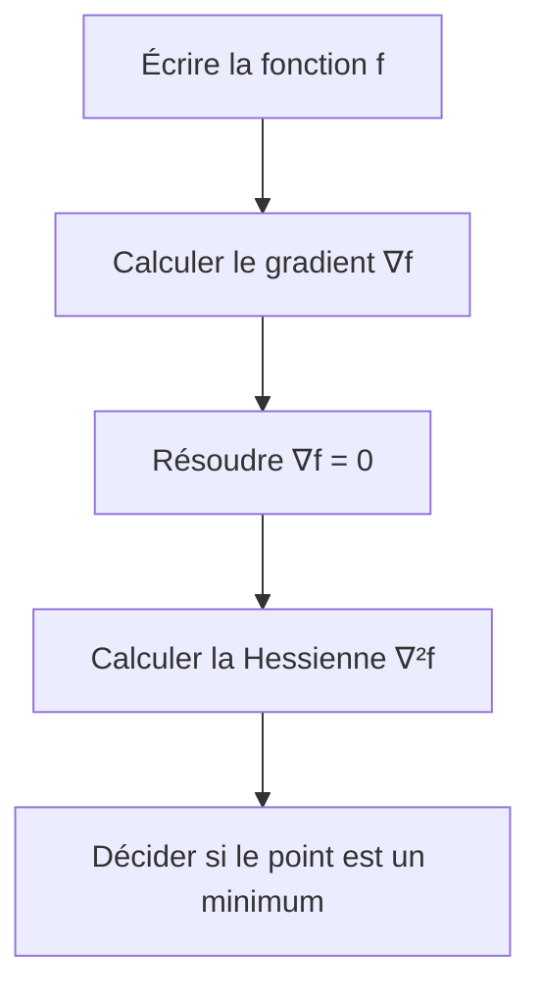

# Exercices et exemples — Optimisation non linéaire

> [!abstract] À quoi sert cette note
> Cette fiche accompagne [[00-Optimisation-non-lineaire]]. Elle reprend la même méthode sur des exemples très simples avant de revenir aux exercices du cours.

## La méthode à suivre à chaque fois

> [!tip] Réflexe à avoir
> Un gradient nul signifie seulement que le point est un **candidat**. Il faut encore étudier la Hessienne ou le comportement de la fonction.

## Exemple 1 — Une variable, pas à pas

On cherche le minimum de :

$$
f(x) = x^2 - 6x + 13.
$$

### Étape 1 — Calculer la dérivée

$$
f'(x) = 2x - 6.
$$

### Étape 2 — Chercher le point stationnaire

$$
2x - 6 = 0
\qquad \Longrightarrow \qquad
x^\star = 3.
$$

### Étape 3 — Vérifier la dérivée seconde

$$
f''(x) = 2 > 0.
$$

La courbe est tournée vers le haut. Le point $x^\star = 3$ est donc un minimum.

### Étape 4 — Calculer la valeur minimale

$$
f(3) = 3^2 - 6 \times 3 + 13 = 4.
$$

> [!success] Réponse
> Le minimum est atteint en $x^\star = 3$ et sa valeur est $4$.

## Exemple 2 — Deux variables

On cherche le minimum de :

$$
f(x_1,x_2) = (x_1-1)^2 + (x_2+2)^2.
$$

### Étape 1 — Gradient

$$
\nabla f(x_1,x_2) =
\begin{pmatrix}
2(x_1-1) \\
2(x_2+2)
\end{pmatrix}.
$$

### Étape 2 — Point stationnaire

$$
\begin{cases}
2(x_1-1) = 0 \\
2(x_2+2) = 0
\end{cases}
\qquad \Longrightarrow \qquad
(x_1^\star,x_2^\star) = (1,-2).
$$

### Étape 3 — Hessienne

$$
\nabla^2 f(x_1,x_2) =
\begin{pmatrix}
2 & 0 \\
0 & 2
\end{pmatrix}.
$$

Cette matrice est positive. Le point $(1,-2)$ est donc un minimum global.

$$
f(1,-2) = 0.
$$

> [!success] Idée à retenir
> Une somme de carrés est toujours positive ou nulle. Elle atteint son minimum quand tous les carrés valent $0$.

## Exemple 3 — L'exercice du cours avec contrainte

Considérons :

$$
\begin{aligned}
\min \quad & f(x) = 2x_1^2 + 4x_2^2 \\
\text{sous contraintes} \quad & x_1^2 + x_2^2 \leq 4 \\
& x \in \mathbb{R}_+^2.
\end{aligned}
$$

Le point $(0,0)$ respecte les contraintes car :

$$
0^2 + 0^2 \leq 4
\qquad \text{et} \qquad
(0,0) \in \mathbb{R}_+^2.
$$

De plus, $2x_1^2 \geq 0$ et $4x_2^2 \geq 0$. On a donc toujours :

$$
f(x) \geq 0.
$$

Or :

$$
f(0,0) = 0.
$$

> [!success] Réponse
> Le point $x^\star = (0,0)$ est un minimum global. Ici, il n'est même pas nécessaire de calculer le gradient pour le voir.

## Exemple bonus — Sly Cooper

> [!example] Situation imagée
> Sly doit choisir son temps de repérage $x_1$ et son nombre de gadgets $x_2$. Le risque de rater la mission est modélisé par :

$$
R(x_1,x_2) = (x_1-2)^2 + 2(x_2-1)^2.
$$

Le meilleur choix est celui qui annule les deux carrés :

$$
(x_1^\star,x_2^\star) = (2,1).
$$

Le risque minimal vaut :

$$
R(2,1) = 0.
$$

> [!tip] Traduction simple
> Le minimum se situe là où Sly est exactement à l'équilibre entre repérage et équipement. S'il s'éloigne de ce point, au moins un carré devient positif et le risque augmente.

## Exercices à faire seul

### Exercice 1 — Dérivée et minimum

Déterminer le minimum de :

$$
f(x) = x^2 + 4x + 5.
$$

> [!success]- Correction
> $f'(x)=2x+4$. Le point stationnaire vérifie $2x+4=0$, donc $x^\star=-2$.
>
> $f''(x)=2>0$, donc c'est un minimum.
>
> $f(-2)=4-8+5=1$. Le minimum vaut $1$ et il est atteint en $-2$.

### Exercice 2 — Gradient et Hessienne

Déterminer le minimum de :

$$
f(x_1,x_2) = x_1^2 + 3x_2^2.
$$

> [!success]- Correction
> $\nabla f(x_1,x_2)=(2x_1,6x_2)^T$. Le seul point stationnaire est $(0,0)$.
>
> $\nabla^2 f(x_1,x_2)=\begin{pmatrix}2&0\\0&6\end{pmatrix}$. Ses deux coefficients diagonaux sont positifs, donc elle est définie positive.
>
> Le minimum global est $f(0,0)=0$.

### Exercice 3 — Attention au piège

Étudier le point $x^\star=0$ pour :

$$
f(x)=x^3.
$$

Le point est-il un minimum local ?

> [!warning]- Correction
> Non. On a bien $f'(0)=0$ et $f''(0)=0$, mais la fonction est négative à gauche de $0$ et positive à droite de $0$.
>
> Le point $0$ n'est donc ni minimum ni maximum. Un gradient nul ne suffit jamais à conclure seul.

### Exercice 4 — Reconnaître un minimum sans dériver

Montrer que le problème suivant a un minimum global :

$$
\min_{x \in \mathbb{R}^2} \quad
(x_1-4)^2 + (x_2+1)^2.
$$

> [!success]- Correction
> Chaque carré est positif ou nul. La somme est donc toujours supérieure ou égale à $0$.
>
> Elle vaut $0$ lorsque $x_1=4$ et $x_2=-1$. Le minimum global est atteint en $(4,-1)$.

## Mini-résumé

| Situation | Ce qu'il faut faire |
| --- | --- |
| Une variable | Résoudre $f'(x)=0$ puis regarder $f''(x)$ |
| Plusieurs variables | Résoudre $\nabla f(x)=0$ puis étudier $\nabla^2f(x)$ |
| Somme de carrés | Chercher si tous les carrés peuvent être nuls |
| Gradient nul | Ne pas conclure trop vite |
| Contrainte | Vérifier que le point trouvé est autorisé |
