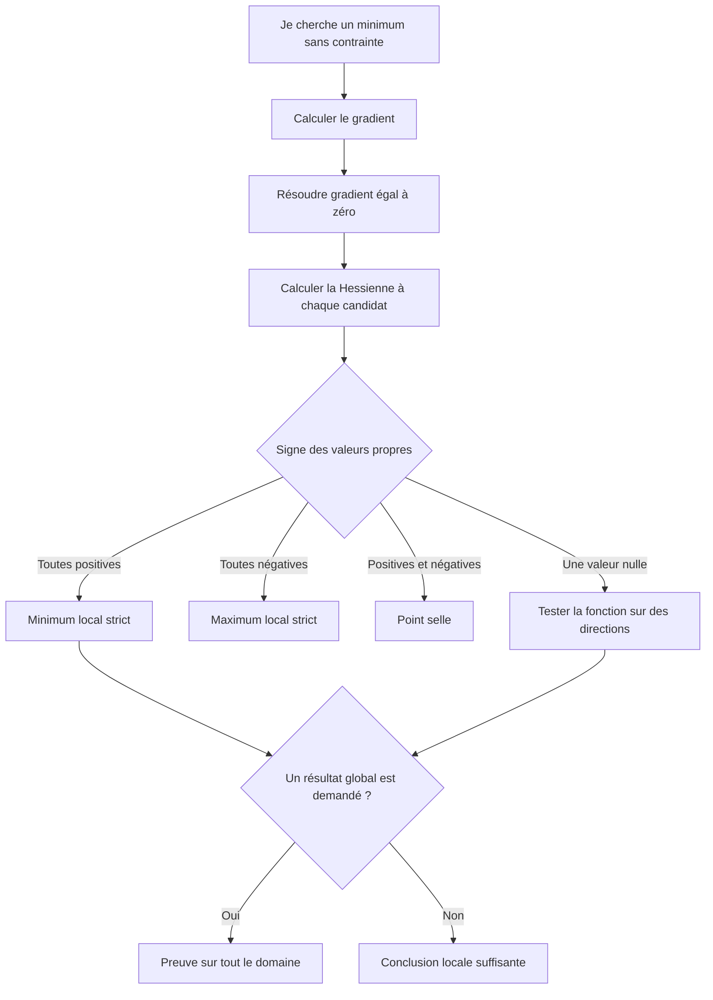

# 🧮 TD 1 — Optimisation non linéaire sans contrainte

> [!info] Comment lire cette note
> Cette page regroupe la feuille du **TD 1** et la correction photographiée du 3 novembre 2026. Les photos montrent surtout les exercices 2 et 3. Les explications supplémentaires, ainsi que les parties de correction non visibles au tableau, sont indiquées comme des **compléments**. Les [[Archives photographiques - TD1|31 photographies originales]] sont conservées.

> [!abstract] Comment ce TD se relie aux autres notes
> Les exercices 1 et 2 correspondent aux exemples déjà présents dans [[02-Calculs-gradient-et-hessienne|Calculs de gradient et de Hessienne]]. Cette page rassemble les questions de la feuille et la suite de leur correction. Pour revoir les calculs de matrices, ouvre [[08-Comprendre-la-hessienne-pas-a-pas|la Hessienne pas à pas]]. Les exercices pour s'entraîner sont dans [[01-Exercices-et-exemples]].

> [!success] Objectif
> Après cette note, tu dois pouvoir refaire **sans regarder** les quatre exercices. Lis chaque étape, cache la suite de la correction, fais le calcul sur une feuille, puis compare. Les blocs « À toi » à la fin servent à vérifier que tu as compris la méthode et pas seulement reconnu le résultat.

## 🗺️ Sommaire

1. [[#Avant de commencer — les outils indispensables|Les bases à connaître]]
2. [[#Exercice 1 — Gradient et Hessienne|Dérivées, gradients et Hessiennes]]
3. [[#Exercice 2 — Points stationnaires et directions propres|Points stationnaires et directions propres]]
4. [[#Exercice 3 — Fonction quadratique en dimension 3|Fonction quadratique et critère de Sylvester]]
5. [[#Exercice 4 — Étude de convexité|Trois études de convexité]]
6. [[#Entraînement — refaire sans la correction|Exercices pour refaire seul]]
7. [[#✅ À retenir pour le contrôle|Résumé]]

---

## Avant de commencer — les outils indispensables

### Quel problème résout-on ?

**Optimiser** une fonction signifie chercher les valeurs des variables qui rendent cette fonction aussi petite ou aussi grande que possible. Ici, les variables peuvent prendre n'importe quelle valeur réelle, car le TD est **sans contrainte**. Le mot **non linéaire** indique que la fonction contient, par exemple, des carrés, des puissances ou des exponentielles.

Pour un **minimum local**, on compare $f(x^\star)$ aux valeurs en des points proches de $x^\star$. Pour un **minimum global**, on compare à **tous** les points du domaine. Un minimum local n'est donc pas forcément global.

> [!example] Image mentale avec Sly Cooper
> Imagine un terrain avec plusieurs vallées. Un minimum local est le fond d'une vallée, même si une autre vallée est plus basse. Un minimum global est le point le plus bas de tout le terrain. La Hessienne décrit la forme du terrain **près d'un point**, tandis qu'une preuve globale doit couvrir **tout le terrain**.

### Les symboles à lire sans hésiter

| Écriture | Lecture | Utilité dans le TD |
|---|---|---|
| $x=(x_1,x_2)^T$ | Vecteur colonne de deux nombres | Représente un point du plan |
| $\partial f/\partial x_1$ | Dérivée partielle selon $x_1$ | On dérive en gardant $x_2$ constant |
| $\nabla f$ | Gradient | Colonne de toutes les dérivées premières |
| $\nabla^2 f$ ou $H_f$ | Hessienne | Matrice de toutes les dérivées secondes |
| $Q^T$ | Transposée de $Q$ | Les lignes et les colonnes sont échangées |
| $I$ | Matrice identité | Sert dans $\det(H-\lambda I)$ |
| $x^\star$ | Point optimal recherché | Une étoile indique une solution |

Avec deux variables, remplis toujours la Hessienne dans le même ordre :

$$
\nabla f=\begin{pmatrix}f_{x_1}\\f_{x_2}\end{pmatrix}
\qquad
\nabla^2f=
\begin{pmatrix}
\partial_{x_1}(f_{x_1})&\partial_{x_2}(f_{x_1})\\
\partial_{x_1}(f_{x_2})&\partial_{x_2}(f_{x_2})
\end{pmatrix}.
$$

Les deux cases hors diagonale doivent être égales pour les fonctions de ce TD. Si elles diffèrent, vérifie tes dérivées.

### Les quatre réflexes de calcul

1. **Puissance** : $(x^m)'=mx^{m-1}$. Par exemple, $(x^4)'=4x^3$.
2. **Produit** : $(uv)'=u'v+uv'$. Il faut dériver **chacun** des deux facteurs à son tour.
3. **Composition** : $(e^{u(x)})'=u'(x)e^{u(x)}$ et $(\ln u(x))'=u'(x)/u(x)$ lorsque $u(x)>0$.
4. **Dérivée partielle** : selon $x_1$, le terme $x_2^4$ vaut une constante, donc sa dérivée est $0$. En revanche, $(4x_1x_2)_{x_1}=4x_2$.

> [!tip] Procédure commune aux exercices 2 et 3
> **Étape 1** : calculer le gradient. **Étape 2** : résoudre $\nabla f=0$ pour trouver les points stationnaires. **Étape 3** : calculer la Hessienne et son signe en chaque point. **Étape 4** : si le test est muet, revenir à la fonction elle-même. **Étape 5** : si l'énoncé demande un résultat global, fournir une raison valable sur tout le domaine.

---

## Exercice 1 — Gradient et Hessienne

### 📋 Énoncé de la feuille

Pour chacune des fonctions suivantes, préciser le domaine de définition, puis calculer le gradient et, lorsqu'elle existe, la Hessienne :

$$
\begin{aligned}
f_1(x)&=e^x
& f_2(x)&=\ln x\\
f_3(x)&=\ln\left(\sum_{i=1}^{n}e^{x_i}\right)
& f_4(x)&=\sum_{i=1}^{n}c_ix_i\\
f_5(x)&=x^TQx+c^Tx+r
& f_6(x_1,x_2)&=x_1e^{-(x_1+3x_2)}.
\end{aligned}
$$

Ici $x\in\mathbb R^n$, les coefficients $c_i$ sont constants, $Q\in\mathbb R^{n\times n}$ n'est pas nécessairement symétrique, $c\in\mathbb R^n$ et $r\in\mathbb R$.

### 1. Exponentielle et logarithme

| Fonction | Domaine | Dérivée première | Dérivée seconde |
|---|---|---|---|
| $e^x$ | $\mathbb R$ | $e^x$ | $e^x$ |
| $\ln x$ | $]0,+\infty[$ | $1/x$ | $-1/x^2$ |

En dimension 1, le gradient est la dérivée première et la Hessienne est la matrice à une case contenant la dérivée seconde.

**Comment retrouver ce tableau ?** L'exponentielle est définie pour tout réel et sa dérivée est elle-même. Le logarithme ne s'applique qu'à un nombre **strictement positif**. Pour retrouver sa dérivée seconde, on écrit $1/x=x^{-1}$ puis on applique la règle des puissances : $(x^{-1})'=-x^{-2}=-1/x^2$. Avant de calculer une dérivée, cherche donc toujours le domaine.

### 2. Logarithme d'une somme d'exponentielles

Le domaine de $f_3$ est $\mathbb R^n$, car chaque exponentielle est positive et leur somme aussi. Posons :

$$
S=\sum_{i=1}^ne^{x_i}
\qquad
p_j=\frac{e^{x_j}}{S}.
$$

Par la dérivée du logarithme et la règle de la chaîne :

$$
\frac{\partial f_3}{\partial x_j}=\frac{e^{x_j}}S=p_j
\qquad
\nabla f_3=(p_1,\ldots,p_n)^T.
$$

Pourquoi $\partial S/\partial x_j=e^{x_j}$ ? Dans la somme $e^{x_1}+\cdots+e^{x_n}$, seul le terme $e^{x_j}$ dépend de $x_j$. Tous les autres termes se comportent comme des constantes. De plus, les $p_j$ sont positifs et leur somme vaut $1$, car leur numérateur total vaut $S$.

Pour obtenir une case de la Hessienne, on dérive $p_j=e^{x_j}/S$ avec la règle du quotient. **Sur la diagonale**, on dérive selon la même variable $x_j$, donc le numérateur et le dénominateur changent :

$$
\frac{\partial p_j}{\partial x_j}
=\frac{e^{x_j}S-e^{x_j}e^{x_j}}{S^2}
=\frac{e^{x_j}}S-\left(\frac{e^{x_j}}S\right)^2
=p_j(1-p_j).
$$

**Hors de la diagonale**, lorsque $k\ne j$, le numérateur $e^{x_j}$ reste constant par rapport à $x_k$, mais le dénominateur change :

$$
\frac{\partial p_j}{\partial x_k}
=\frac{0\cdot S-e^{x_j}e^{x_k}}{S^2}
=-p_jp_k.
$$

Pour la Hessienne :

$$
\frac{\partial^2f_3}{\partial x_j\partial x_k}
=
\begin{cases}
p_j(1-p_j) & \text{si }j=k\\
-p_jp_k & \text{si }j\neq k.
\end{cases}
$$

En notation matricielle :

$$
\nabla^2 f_3=\operatorname{diag}(p)-pp^T.
$$

> [!example] Vérification en deux variables
> Si $x_1=x_2=0$, alors $S=2$ et $p_1=p_2=1/2$. La Hessienne vaut $\begin{pmatrix}1/4&-1/4\\-1/4&1/4\end{pmatrix}$. Les valeurs sur la diagonale sont positives et les cases croisées négatives. Cela te permet de contrôler les signes de ta formule.

> [!tip] D'où viennent ces cases ?
> La dérivation du quotient, pour les deux cas $j=k$ et $j\neq k$, est détaillée dans [[02-Calculs-gradient-et-hessienne#Détail du calcul de chaque case|la fiche de calculs]].

### 3. Fonction linéaire

La fonction $f_4$ est définie sur $\mathbb R^n$. Chaque dérivée première est constante, donc les dérivées secondes sont nulles :

$$
\nabla f_4=c
\qquad
\nabla^2f_4=0.
$$

### 4. Fonction quadratique avec une matrice quelconque

La fonction $f_5$ est définie sur $\mathbb R^n$. Le résultat général est :

$$
\nabla f_5=(Q+Q^T)x+c
\qquad
\nabla^2 f_5=Q+Q^T.
$$

Pour comprendre d'où sort $Q+Q^T$, écris $x^TQx=\sum_{i,j}Q_{ij}x_ix_j$. Quand on dérive selon $x_k$, $x_k$ peut apparaître **à la première place** ($i=k$) ou **à la deuxième** ($j=k$). On obtient donc $\sum_jQ_{kj}x_j+\sum_iQ_{ik}x_i$, c'est-à-dire la composante $k$ de $(Q+Q^T)x$. Le terme $c^Tx$ ajoute $c$ au gradient et $r$ disparaît.

> [!warning] Une erreur fréquente
> La formule $2Qx$ n'est valable que lorsque $Q$ est symétrique. Si la case $(1,2)$ de $Q$ diffère de la case $(2,1)$, calcule d'abord $Q^T$.

Si $Q$ est symétrique, on retrouve $2Qx+c$ et $2Q$. Le facteur 2 vient des deux contributions des termes quadratiques. Un exemple chiffré est développé dans [[08-Comprendre-la-hessienne-pas-a-pas#2. Exemple du cours, calcul de chaque case|la fiche Hessienne]].

### 5. Produit d'une variable par une exponentielle

> [!note] Complément de correction
> Cette fonction apparaît sur la feuille. Sa correction détaillée n'est pas visible sur les photos du tableau.

Posons $E=e^{-(x_1+3x_2)}$. Le domaine est $\mathbb R^2$. Avec la règle du produit et la règle de la chaîne :

$$
\frac{\partial E}{\partial x_1}=-E
\qquad
\frac{\partial E}{\partial x_2}=-3E.
$$

D'où :

$$
\begin{aligned}
\frac{\partial f_6}{\partial x_1}
&=1\cdot E+x_1(-E)=(1-x_1)E\\
\frac{\partial f_6}{\partial x_2}
&=x_1(-3E)=-3x_1E.
\end{aligned}
$$

Le gradient et la Hessienne sont :

$$
\nabla f_6=E\begin{pmatrix}1-x_1\\-3x_1\end{pmatrix}
\qquad
\nabla^2f_6
=E\begin{pmatrix}
x_1-2&3(x_1-1)\\
3(x_1-1)&9x_1
\end{pmatrix}.
$$

Pour vérifier les trois autres cases, repars **des composantes du gradient**, sans mémoriser la matrice :

$$
\begin{aligned}
\partial_{x_2}\big((1-x_1)E\big)
&=(1-x_1)(-3E)=3(x_1-1)E\\
\partial_{x_1}\big(-3x_1E\big)
&=-3E-3x_1(-E)=3(x_1-1)E\\
\partial_{x_2}\big(-3x_1E\big)
&=-3x_1(-3E)=9x_1E.
\end{aligned}
$$

Les deux calculs croisés donnent le même résultat. C'est un bon contrôle de ta réponse.

Par exemple, pour la case en haut à gauche, on dérive à nouveau le produit :

$$
\frac{\partial}{\partial x_1}\big((1-x_1)E\big)
=-E-(1-x_1)E=(x_1-2)E.
$$

---

## Exercice 2 — Points stationnaires et directions propres

### 📋 Énoncé de la feuille

On considère sur $\mathbb R^2$ :

$$
f(x_1,x_2)=x_1^4+x_2^4-2x_1^2+4x_1x_2-2x_2^2.
$$

1. Calculer $\nabla f$ et $\nabla^2 f$.
2. Déterminer les points stationnaires.
3. Étudier les valeurs propres de la Hessienne à chaque point et conclure lorsque le critère le permet.
4. Si nécessaire, étudier la fonction le long de directions propres.
5. Donner le développement de Taylor-Young à l'ordre 2 au voisinage de l'origine.

### 1. Calcul du gradient

On dérive par rapport à une variable en gardant l'autre constante :

Avant de regarder le résultat, sépare les cinq termes de $f$. Par rapport à $x_1$, leurs dérivées sont respectivement $4x_1^3$, $0$, $-4x_1$, $4x_2$ et $0$. Par rapport à $x_2$, elles sont $0$, $4x_2^3$, $0$, $4x_1$ et $-4x_2$. Le terme croisé $4x_1x_2$ contribue donc aux **deux** composantes du gradient.

$$
\begin{aligned}
\frac{\partial f}{\partial x_1}
&=4x_1^3-4x_1+4x_2\\
\frac{\partial f}{\partial x_2}
&=4x_2^3+4x_1-4x_2.
\end{aligned}
$$

On peut factoriser $4$ :

$$
\nabla f(x)=4
\begin{pmatrix}
x_1^3-x_1+x_2\\
x_2^3+x_1-x_2
\end{pmatrix}.
$$

### 2. Calcul de la Hessienne

On dérive chaque composante du gradient :

$$
\nabla^2 f(x)=
\begin{pmatrix}
12x_1^2-4&4\\
4&12x_2^2-4
\end{pmatrix}
=4\begin{pmatrix}
3x_1^2-1&1\\
1&3x_2^2-1
\end{pmatrix}.
$$

Si tu veux refaire le calcul case par case, pars de $f_{x_1}=4x_1^3-4x_1+4x_2$. Sa dérivée selon $x_1$ vaut $12x_1^2-4$ et sa dérivée selon $x_2$ vaut $4$. Ensuite, pars de $f_{x_2}=4x_2^3+4x_1-4x_2$. Sa dérivée selon $x_1$ vaut $4$ et sa dérivée selon $x_2$ vaut $12x_2^2-4$. Vérifie que la Hessienne est symétrique.

> [!example] Pourquoi y a-t-il un 4 hors de la matrice ?
> $12x_1^2-4=4(3x_1^2-1)$. La case croisée vaut $4=4\times1$. On peut donc mettre le même facteur 4 devant toute la matrice.

### 3. Trouver les points stationnaires

On cherche $\nabla f=0$. Comme $4\neq0$, on peut simplifier le système :

$$
\begin{cases}
x_1^3-x_1+x_2=0\\
x_2^3-x_2+x_1=0.
\end{cases}
$$

En additionnant les deux équations, les termes linéaires s'annulent :

$$
x_1^3+x_2^3=0
\quad\Longrightarrow\quad
x_1^3=(-x_2)^3
\quad\Longrightarrow\quad
x_1=-x_2.
$$

La fonction cube étant strictement croissante sur $\mathbb R$, l'égalité des cubes entraîne l'égalité des nombres. En remplaçant $x_2$ par $-x_1$ dans la première équation :

$$
x_1^3-2x_1=x_1(x_1^2-2)=0.
$$

Les trois candidats sont donc :

$$
x^{(0)}=(0,0)
\qquad
x^{(1)}=(\sqrt2,-\sqrt2)
\qquad
x^{(2)}=(-\sqrt2,\sqrt2).
$$

Les indices entre parenthèses servent à nommer les points. Ici, ils ne désignent pas des itérations d'un algorithme.

**Pourquoi la liste est-elle complète ?** Tout point stationnaire doit vérifier les deux équations. Leur somme impose $x_2=-x_1$. En réinjectant cette relation, on obtient un produit nul à trois solutions réelles exactement. On n'a donc écarté aucun candidat. Pour vérifier l'étape inverse, remplace chacun des trois points dans **les deux** composantes du gradient.

> [!tip] Quand additionner les équations ?
> Regarde si des termes s'annulent. Ici, $-x_1+x_1$ et $x_2-x_2$ disparaissent immédiatement. C'est plus simple que de résoudre l'une des équations pour une variable puis de développer un cube.

### 4. Étudier les deux points non nuls

Pour $x^{(1)}$ et $x^{(2)}$, les deux coordonnées ont un carré égal à 2. On remplace dans la Hessienne :

$$
\nabla^2 f(x^{(1)})=\nabla^2 f(x^{(2)})
=4\begin{pmatrix}3(2)-1&1\\1&3(2)-1\end{pmatrix}
=4\begin{pmatrix}5&1\\1&5\end{pmatrix}.
$$

Le tableau étudie d'abord $A=\begin{pmatrix}5&1\\1&5\end{pmatrix}$. Pour trouver ses valeurs propres :

$$
\begin{aligned}
\det(A-\lambda I)
&=\begin{vmatrix}5-\lambda&1\\1&5-\lambda\end{vmatrix}\\
&=(5-\lambda)^2-1\\
&=(4-\lambda)(6-\lambda).
\end{aligned}
$$

Les valeurs propres de **$A$** sont $4$ et $6$. La Hessienne vaut **$4A$**. Ses valeurs propres sont donc $4\times4=16$ et $4\times6=24$.

Tu peux retrouver les directions de $A$ sans formule compliquée. Pour la valeur propre $6$, résous $(A-6I)v=0$, soit $-v_1+v_2=0$. La direction est $(1,1)$. Pour la valeur propre $4$, résous $(A-4I)v=0$, soit $v_1+v_2=0$. La direction est $(1,-1)$. Multiplier la matrice par $4$ change les valeurs propres, mais **pas les directions propres**.

Une matrice symétrique dont toutes les valeurs propres sont strictement positives est **définie positive**. Géométriquement, la fonction remonte autour du point dans toutes les directions. Comme le gradient y est nul, le critère du second ordre donne un minimum local strict. Ce résultat ne compare pas encore ces points aux valeurs de $f$ très loin.

> [!important] Bien distinguer les deux matrices
> $4$ et $6$ sont les valeurs propres de la petite matrice $A$. Celles de la Hessienne complète sont $16$ et $24$. Elles sont toutes positives, donc les deux points sont des **minima locaux stricts**.

### 5. Étudier la Hessienne à l'origine

$$
H_0=\nabla^2 f(0,0)
=4\begin{pmatrix}-1&1\\1&-1\end{pmatrix}
=\begin{pmatrix}-4&4\\4&-4\end{pmatrix}.
$$

On cherche les racines de son polynôme caractéristique :

$$
\begin{aligned}
\det(H_0-\lambda I)
&=\begin{vmatrix}-4-\lambda&4\\4&-4-\lambda\end{vmatrix}\\
&=(-4-\lambda)^2-16\\
&=(\lambda+4)^2-16\\
&=\lambda(\lambda+8).
\end{aligned}
$$

Les valeurs propres sont donc **$0$ et $-8$**. La Hessienne est semi-définie négative. Elle exclut un minimum local, mais le test du second ordre ne suffit pas à décider à lui seul entre un maximum et un point selle.

Voici ce que signifient les trois cas du test en un **point stationnaire** :

| Signe de toutes les valeurs propres | Conclusion locale |
|---|---|
| Toutes strictement positives | Minimum local strict |
| Toutes strictement négatives | Maximum local strict |
| Au moins une positive et une négative | Point selle |
| Au moins une nulle, sans signes opposés | Test du second ordre insuffisant |

À l'origine, le $0$ signifie que la courbure mesurée par la Hessienne est nulle dans une direction. Il faut regarder les termes plus fins de $f$. Une valeur propre négative prouve déjà que l'origine **ne peut pas être un minimum local** : dans la direction correspondante, $f$ diminue pour de petits déplacements.

### 6. Retrouver les directions propres

Pour $\lambda=0$, on résout $H_0v=0$ :

$$
\begin{cases}
-4v_1+4v_2=0\\
4v_1-4v_2=0.
\end{cases}
\quad\Longrightarrow\quad v_1=v_2.
$$

Une direction propre est $(1,1)$. Pour avoir une norme égale à 1, on la divise par $\sqrt{1^2+1^2}=\sqrt2$ :

$$
u_0=\frac1{\sqrt2}\begin{pmatrix}1\\1\end{pmatrix}.
$$

Pour $\lambda=-8$, on résout $(H_0+8I)v=0$. On obtient $v_1=-v_2$, donc :

$$
u_{-8}=\frac1{\sqrt2}\begin{pmatrix}1\\-1\end{pmatrix}.
$$

Ces vecteurs et leurs opposés sont normalisés. Tout multiple non nul représente la même direction propre.

**Comment contrôler une direction propre ?** Multiplie la matrice par le vecteur. Par exemple, $H_0(1,1)^T=(0,0)^T=0(1,1)^T$. Et $H_0(1,-1)^T=(-8,8)^T=-8(1,-1)^T$. Tu retrouves directement les deux valeurs propres.

### 7. Comparer les valeurs de $f$ dans les deux directions

On peut utiliser les directions **non normalisées** $(1,1)$ et $(1,-1)$. Elles définissent les mêmes droites que $u_0$ et $u_{-8}$. Pour un paramètre réel $t$ :

$$
f(t,t)=t^4+t^4-2t^2+4t^2-2t^2=2t^4.
$$

Ainsi $f(t,t)>f(0,0)=0$ pour $t\neq0$. Dans l'autre direction :

$$
\begin{aligned}
f(t,-t)
&=t^4+t^4-2t^2-4t^2-2t^2\\
&=2t^4-8t^2\\
&=2t^2(t-2)(t+2).
\end{aligned}
$$

| Valeur de $t$ | $t<-2$ | $t=-2$ | $-2<t<0$ | $t=0$ | $0<t<2$ | $t=2$ | $t>2$ |
|---|---|---|---|---|---|---|---|
| Signe de $f(t,-t)$ | $+$ | $0$ | $-$ | $0$ | $-$ | $0$ | $+$ |

Des valeurs supérieures et inférieures à $f(0,0)$ existent arbitrairement près de l'origine. **L'origine est un point selle.**

Pour une preuve locale, il suffit de choisir $t$ **aussi petit que l'on veut**, avec $0<|t|<1$. Alors $f(t,t)=2t^4>0$, tandis que $f(t,-t)=2t^2(t^2-4)<0$. Le grand tableau de signes ci-dessus décrit toute la droite, mais ce petit intervalle suffit à établir le point selle.

> [!warning] Facteur de normalisation
> Le tableau écrit parfois des vecteurs normalisés puis des points $(t,t)$ et $(t,-t)$. Ces points utilisent les vecteurs non normalisés. Cela ne change pas les droites étudiées, mais le paramètre n'a pas la même échelle.

### 8. Taylor-Young à l'ordre 2

Comme $f(0)=0$ et $\nabla f(0)=0$ :

$$
\begin{aligned}
f(x)
&=\frac12x^TH_0x+o(\lVert x\rVert^2)\\
&=-2x_1^2+4x_1x_2-2x_2^2
  +o(\lVert x\rVert^2)\\
&=-2(x_1-x_2)^2+o(\lVert x\rVert^2).
\end{aligned}
$$

Ici, on connaît même le reste exactement : $x_1^4+x_2^4$, qui est bien négligeable devant $\lVert x\rVert^2$ lorsque $x\to0$. L'approximation d'ordre 2 est nulle le long de $x_1=x_2$. C'est pourquoi il faut regarder les termes d'ordre supérieur dans cette direction.

Pour retrouver la formule, pars de $f(0)=0$, puis du terme linéaire $\nabla f(0)^Tx=0$. Le terme quadratique est $\tfrac12x^TH_0x$. Développons vraiment le produit :

$$
H_0x=\begin{pmatrix}-4x_1+4x_2\\4x_1-4x_2\end{pmatrix}
\quad\Longrightarrow\quad
x^TH_0x=-4x_1^2+8x_1x_2-4x_2^2.
$$

Le facteur $1/2$ donne bien $-2x_1^2+4x_1x_2-2x_2^2$. Le reste est $x_1^4+x_2^4$. On peut même le borner par $(x_1^2+x_2^2)^2=\lVert x\rVert^4$, donc son quotient par $\lVert x\rVert^2$ tend vers $0$.

### 9. Les deux minima sont-ils globaux ?

> [!note] Complément de correction
> La preuve globale suivante complète le résultat local du tableau.

On réécrit la fonction comme somme de termes positifs :

$$
f(x)=(x_1^2-2)^2+(x_2^2-2)^2
+2(x_1+x_2)^2-8\geq-8.
$$

Aux deux points $(\sqrt2,-\sqrt2)$ et $(-\sqrt2,\sqrt2)$, les trois carrés sont nuls. Ils atteignent donc tous deux la valeur $-8$. Ce sont les **deux minima globaux**.

**Comment inventer cette écriture ?** On part de $x_1^4+x_2^4$ et on souhaite faire apparaître $(x_i^2-2)^2=x_i^4-4x_i^2+4$. Les deux carrés produisent $-4x_1^2-4x_2^2$, alors que $f$ contient $-2x_1^2-2x_2^2+4x_1x_2$. Il manque donc $2x_1^2+4x_1x_2+2x_2^2=2(x_1+x_2)^2$. Les deux carrés ajoutent aussi $8$ en constante, qu'on retire à la fin. Pour atteindre la borne $-8$, il faut simultanément $x_1^2=x_2^2=2$ et $x_1+x_2=0$, ce qui laisse exactement les deux points annoncés.

---

## Exercice 3 — Fonction quadratique en dimension 3

### 📋 Énoncé de la feuille

On considère :

$$
q(x)=\frac12x^TAx+b^Tx+c
\qquad
A=\begin{pmatrix}
5&-2&1\\
-2&6&4\\
1&4&5
\end{pmatrix}
\qquad
b=-2\begin{pmatrix}4\\12\\12\end{pmatrix}.
$$

La feuille demande de calculer le gradient et la Hessienne, montrer que $A$ est définie positive, en déduire l'existence d'un minimum global unique, puis calculer son point et sa valeur.

### 1. Gradient et Hessienne

La matrice $A$ est symétrique, donc $A^T=A$. La formule générale donne :

$$
\nabla q(x)=\frac12(A+A^T)x+b=Ax+b
\qquad
\nabla^2q(x)=A.
$$

**Ce que signifie $x^TAx$ :** $x$ est une colonne, $x^T$ est la même liste écrite en ligne. Le produit $Ax$ est une colonne et $x^T(Ax)$ est un nombre. Ici, si tu développes entièrement $q$, tu retrouves :

$$
q(x)=\frac52x_1^2+3x_2^2+\frac52x_3^2
-2x_1x_2+x_1x_3+4x_2x_3
-8x_1-24x_2-24x_3+c.
$$

Le coefficient de $x_1x_2$ est $-2$ car les deux cases $A_{12}=A_{21}=-2$ donnent ensemble $-4x_1x_2$ dans $x^TAx$, puis le facteur $1/2$ le ramène à $-2x_1x_2$. En dérivant cette expression par rapport à $x_1$, tu retrouves bien $5x_1-2x_2+x_3-8$.

Le facteur $1/2$ compense le facteur $2$ issu de la dérivée de $x^TAx$. En composantes, avec $b=(-8,-24,-24)^T$ :

$$
\nabla q(x)=
\begin{pmatrix}
5x_1-2x_2+x_3-8\\
-2x_1+6x_2+4x_3-24\\
x_1+4x_2+5x_3-24
\end{pmatrix}.
$$

### 2. Deux méthodes pour vérifier le signe de $A$

Le tableau propose le calcul des valeurs propres ou le **critère de Sylvester**. Pour une matrice réelle symétrique, ce critère dit qu'elle est définie positive si et seulement si tous ses **mineurs principaux d'ordre croissant**, pris en haut à gauche, sont strictement positifs.

Une matrice $A$ est **définie positive** lorsque $v^TAv>0$ pour tout vecteur non nul $v$. Dans ce TD, cela signifie que la partie quadratique de $q$ est tournée vers le haut dans toutes les directions. Sylvester permet de le démontrer sans calculer les racines d'un polynôme du troisième degré.

Pour une matrice $3\times3$, dessine trois cadres qui grandissent depuis le coin supérieur gauche. Calcule d'abord le nombre $A_{11}$, puis le déterminant du carré $2\times2$, enfin le déterminant de toute la matrice. Tu dois avoir **trois** nombres strictement positifs. Un seul positif ne suffit pas.

> [!warning] Précision sur « les mineurs »
> Il faut ici les déterminants des sous-matrices principales en haut à gauche. On ne demande pas que tous les déterminants de toutes les sous-matrices possibles soient positifs.

#### Premier mineur

$$
\Delta_1=\det(5)=5>0.
$$

#### Deuxième mineur

$$
\Delta_2=
\begin{vmatrix}5&-2\\-2&6\end{vmatrix}
=5\times6-(-2)(-2)=30-4=26>0.
$$

#### Troisième mineur

On développe selon la première ligne, avec les signes $+$, $-$, $+$ :

La règle générale sur une ligne $a,b,c$ est $\det A=aM_{11}-bM_{12}+cM_{13}$, où chaque $M$ est le déterminant obtenu en barrant la ligne et la colonne correspondantes. Le « moins devant $b$ » est déjà dans la formule. Comme $b=-2$ ici, il devient $-(-2)=+2$. C'est le passage où l'on se trompe le plus souvent.

$$
\begin{aligned}
\Delta_3
&=\det A\\
&=5\begin{vmatrix}6&4\\4&5\end{vmatrix}
-(-2)\begin{vmatrix}-2&4\\1&5\end{vmatrix}
+1\begin{vmatrix}-2&6\\1&4\end{vmatrix}\\
&=5(30-16)+2(-10-4)+(-8-6)\\
&=70-28-14=28>0.
\end{aligned}
$$

Les trois mineurs valent $5$, $26$ et $28$. Ils sont strictement positifs, donc **$A$ est définie positive**.

Tu peux contrôler le dernier calcul autrement. Dans les trois petits déterminants, on a respectivement $30-16=14$, $-10-4=-14$ et $-8-6=-14$. Avec les coefficients $5$, $+2$ et $1$, cela fait $5(14)+2(-14)+1(-14)=28$. L'ordre et les signes sont donc cohérents.

> [!tip] Rappel pour une matrice 3 × 3
> Pour calculer un mineur, on barre la ligne et la colonne de la case choisie, puis on calcule le déterminant $2\times2$ restant. Le signe dépend de la position de la case.

### 3. Lien avec les valeurs propres

Le tableau commence aussi le polynôme caractéristique :

$$
\begin{aligned}
\det(A-\lambda I)
&=(5-\lambda)\big((6-\lambda)(5-\lambda)-16\big)\\
&\quad+2\big(-2(5-\lambda)-4\big)
+\big(-8-(6-\lambda)\big).
\end{aligned}
$$

> [!note] Complément
> En développant, on obtient $-\lambda^3+16\lambda^2-64\lambda+28$. Les valeurs propres sont approximativement $0{,}497$, $5{,}803$ et $9{,}699$. Elles sont positives. Il n'est pas nécessaire de résoudre ce polynôme pour appliquer Sylvester.

### 4. Pourquoi y a-t-il un minimum global unique ?

La Hessienne de $q$ vaut $A$, définie positive partout. La fonction est strictement convexe. Dans ce cas quadratique, le terme $x^TAx/2$ croît quand $\lVert x\rVert$ devient grand, ce qui garantit aussi l'existence d'un minimum. L'unique point qui annule le gradient est donc l'unique minimum global.

Une preuve plus concrète consiste à comparer n'importe quel point $x$ à la solution stationnaire $x^\star$. Si $Ax^\star=-b$, alors en écrivant $x=x^\star+h$ et en développant, les termes linéaires en $h$ s'annulent :

$$
q(x^\star+h)-q(x^\star)=\frac12h^TAh.
$$

Comme $A$ est définie positive, ce nombre est strictement positif dès que $h\ne0$. Ainsi **chaque autre point du domaine** a une valeur de $q$ plus grande. Cette égalité prouve à la fois le caractère global et l'unicité, sans s'appuyer uniquement sur un dessin de parabole.

> [!warning] Existence et unicité
> La stricte convexité seule garantit **au plus un** minimum. Il faut aussi justifier qu'il est atteint. Ici, la forme quadratique définie positive assure l'existence.

### 5. Calculer le point minimiseur

Le tableau arrive au système :

$$
\nabla q(x^\star)=0
\quad\Longleftrightarrow\quad
Ax^\star=-b=\begin{pmatrix}8\\24\\24\end{pmatrix}.
$$

> [!note] Complément de correction
> La résolution complète et la valeur minimale ci-dessous ne sont pas visibles sur les photos. Elles sont ajoutées pour terminer les questions de la feuille.

En composantes :

$$
\begin{cases}
5x_1-2x_2+x_3=8\\
-2x_1+6x_2+4x_3=24\\
x_1+4x_2+5x_3=24.
\end{cases}
$$

On isole $x_3=8-5x_1+2x_2$ dans la première équation, puis on remplace dans les deux autres :

Ne saute pas la substitution. Dans la deuxième ligne, on obtient :

$$
\begin{aligned}
-2x_1+6x_2+4(8-5x_1+2x_2)&=24\\
-22x_1+14x_2+32&=24\\
11x_1-7x_2&=4.
\end{aligned}
$$

Dans la troisième ligne, on obtient :

$$
\begin{aligned}
x_1+4x_2+5(8-5x_1+2x_2)&=24\\
-24x_1+14x_2+40&=24\\
12x_1-7x_2&=8.
\end{aligned}
$$

$$
\begin{cases}
11x_1-7x_2=4\\
12x_1-7x_2=8.
\end{cases}
$$

En soustrayant la première équation de la deuxième, on trouve $x_1=4$. Puis :

$$
11(4)-7x_2=4
\quad\Longrightarrow\quad
x_2=\frac{40}{7}
\quad\Longrightarrow\quad
x_3=8-5(4)+2\frac{40}{7}=-\frac47.
$$

Ainsi :

$$
\boxed{x^\star=\begin{pmatrix}4\\40/7\\-4/7\end{pmatrix}.}
$$

> [!success] Vérification obligatoire
> Calcule $Ax^\star$ ligne par ligne. Tu obtiens $20-80/7-4/7=8$, puis $-8+240/7-16/7=24$, puis $4+160/7-20/7=24$. C'est exactement $-b=(8,24,24)^T$. Si une ligne ne donne pas le bon nombre, reprends l'élimination avant de continuer.

### 6. Calculer la valeur minimale

Comme $Ax^\star=-b$, on a $(x^\star)^TAx^\star=-b^Tx^\star$. Donc :

Ce raccourci évite de développer à nouveau les nombreux termes de $q$. Il vient directement de l'équation $Ax^\star=-b$ : multiplie ses deux côtés à gauche par $(x^\star)^T$. Puis, dans $q(x^\star)=\tfrac12(x^\star)^TAx^\star+b^Tx^\star+c$, remplace le terme quadratique par $-b^Tx^\star$. Les deux termes en $b^Tx^\star$ donnent $-\tfrac12b^Tx^\star+b^Tx^\star=\tfrac12b^Tx^\star$.

$$
q(x^\star)=c+\frac12b^Tx^\star.
$$

Or :

$$
b^Tx^\star
=-8(4)-24\frac{40}{7}-24\left(-\frac47\right)
=-\frac{1088}{7}.
$$

La valeur minimale est :

$$
\boxed{q_{\min}=c-\frac{544}{7}.}
$$

Le nombre $c$ n'est pas donné. On le garde donc dans la réponse. Modifier $c$ décale toutes les valeurs de $q$ de la même quantité, sans déplacer le point minimiseur.

---

## Exercice 4 — Étude de convexité

### 📋 Énoncé de la feuille

Pour chaque fonction définie sur $\mathbb R^2$, déterminer si elle est convexe, strictement convexe, concave ou ni convexe ni concave.

**Mode d'emploi pour cet exercice :** une fonction deux fois dérivable est convexe sur $\mathbb R^2$ si sa Hessienne est semi-définie positive partout, c'est-à-dire si $v^TH(x)v\ge0$ pour tout $x$ et tout $v$. Elle est concave si la Hessienne est semi-définie négative partout. Si, à un point, la Hessienne a une valeur propre positive et une négative, la fonction ne peut être ni convexe ni concave sur tout le domaine. Une Hessienne définie positive partout suffit pour la stricte convexité, mais ce n'est pas la seule manière de la prouver.

$$
\begin{aligned}
g_1(x_1,x_2)&=2x_1^2-4x_1x_2-8x_1+3x_2\\
g_2(x_1,x_2)&=e^{-x_1}+2x_1x_2+5x_2+1\\
g_3(x_1,x_2)&=(x_1+x_2)^2+(x_1-x_2)^4.
\end{aligned}
$$

> [!note] Compléments de correction
> Les photos fournies ne montrent pas une correction au tableau de cet exercice. Les solutions ci-dessous sont ajoutées pour t'entraîner avec la feuille.

### 1. Fonction $g_1$

Les termes linéaires disparaissent après deux dérivations :

Pour obtenir cette Hessienne, commence par $\nabla g_1=(4x_1-4x_2-8,\,-4x_1+3)^T$. Dérive la première composante selon $x_1$, puis selon $x_2$, ce qui donne $4$ et $-4$. Dérive la seconde de la même façon, ce qui donne $-4$ et $0$.

$$
\nabla^2g_1=
\begin{pmatrix}4&-4\\-4&0\end{pmatrix}
\qquad
\det(\nabla^2g_1)=4(0)-(-4)^2=-16<0.
$$

Cette Hessienne symétrique possède deux valeurs propres de signes opposés. La fonction est **ni convexe ni concave** sur $\mathbb R^2$.

Pourquoi le déterminant négatif suffit-il ici ? Pour une matrice symétrique $2\times2$, le déterminant est le **produit** des deux valeurs propres. Un produit négatif signifie que l'une est positive et l'autre négative. La courbure change donc de signe selon la direction choisie.

### 2. Fonction $g_2$

La dérivée seconde de $e^{-x_1}$ par rapport à $x_1$ vaut $e^{-x_1}$. Les dérivées croisées de $2x_1x_2$ valent $2$ :

Vérifie la chaîne des dérivations : $(e^{-x_1})_{x_1}=-e^{-x_1}$, puis $(-e^{-x_1})_{x_1}=e^{-x_1}$. Le signe redevient positif au **deuxième** passage. Le gradient complet est $\nabla g_2=(-e^{-x_1}+2x_2,\,2x_1+5)^T$.

$$
\nabla^2g_2=
\begin{pmatrix}e^{-x_1}&2\\2&0\end{pmatrix}
\qquad
\det(\nabla^2g_2)=-4<0.
$$

La Hessienne est indéfinie en tout point. La fonction est **ni convexe ni concave** sur $\mathbb R^2$.

### 3. Fonction $g_3$

Posons $d=x_1-x_2$. La Hessienne est :

Pour comprendre ses cases, calcule d'abord le gradient :

$$
\nabla g_3=
\begin{pmatrix}
2(x_1+x_2)+4(x_1-x_2)^3\\
2(x_1+x_2)-4(x_1-x_2)^3
\end{pmatrix}.
$$

Le signe $-$ de la seconde composante vient de $\partial_{x_2}(x_1-x_2)=-1$. En dérivant encore, la première case diagonale devient $2+12d^2$. La case croisée devient $2-12d^2$. Les deux autres cases s'obtiennent de la même manière.

$$
\nabla^2g_3=
\begin{pmatrix}
2+12d^2&2-12d^2\\
2-12d^2&2+12d^2
\end{pmatrix}.
$$

Ses valeurs propres sont $4$ et $24d^2$. Elles sont positives ou nulles partout, donc $g_3$ est convexe.

On peut retrouver ces valeurs propres sans calculer le déterminant. La direction $(1,1)$ donne $H(1,1)^T=(4,4)^T=4(1,1)^T$. La direction $(1,-1)$ donne $H(1,-1)^T=(24d^2,-24d^2)^T=24d^2(1,-1)^T$. Le signe est alors immédiat puisque $d^2\ge0$.

La Hessienne n'est pas définie positive lorsque $x_1=x_2$. Cela n'empêche pas pour autant la stricte convexité.

Pour le montrer, posons $u=x_1+x_2$ et $v=x_1-x_2$. La transformation $(x_1,x_2)\mapsto(u,v)$ est inversible, et :

$$
g_3=u^2+v^4.
$$

Les fonctions $u\mapsto u^2$ et $v\mapsto v^4$ sont strictement convexes. Deux points distincts ont au moins une coordonnée $u$ ou $v$ différente. L'inégalité de convexité est alors stricte pour cette coordonnée. Donc **$g_3$ est strictement convexe sur $\mathbb R^2$**.

**Pourquoi $v^4$ est-elle strictement convexe malgré sa dérivée seconde nulle en $v=0$ ?** Sa dérivée première $4v^3$ est strictement croissante : si $a<b$, alors $4a^3<4b^3$. Une fonction dérivable dont la dérivée est strictement croissante est strictement convexe. Le point où la dérivée seconde vaut $0$ ne crée donc pas de segment plat. Enfin, on retrouve $(x_1,x_2)$ depuis $(u,v)$ par $x_1=(u+v)/2$ et $x_2=(u-v)/2$, ce qui prouve que deux points distincts ne peuvent pas avoir simultanément le même $u$ et le même $v$.

> [!important] Piège à éviter
> Une Hessienne définie positive partout suffit à prouver la stricte convexité. Ce n'est pas une condition nécessaire. L'exemple $g_3$ est strictement convexe alors que sa Hessienne a une valeur propre nulle sur la droite $x_1=x_2$.

---

## Entraînement — refaire sans la correction

Fais d'abord l'exercice sur papier. Pour chaque réponse, écris **d'où vient chaque dérivée** et **pourquoi** ta conclusion est valable. Les corrections ci-dessous sont repliées dans Obsidian.

### À toi 1 — Remplir une Hessienne

Soit $h(x_1,x_2)=x_1^2+3x_1x_2+2x_2^2-4x_1$. Calcule le gradient, puis les quatre cases de la Hessienne. Dis si $h$ est convexe sur $\mathbb R^2$.

> [!success]- Correction détaillée
> Par rapport à $x_1$, on a $\partial_{x_1}(x_1^2)=2x_1$, $\partial_{x_1}(3x_1x_2)=3x_2$, $\partial_{x_1}(2x_2^2)=0$ et $\partial_{x_1}(-4x_1)=-4$. Donc $h_{x_1}=2x_1+3x_2-4$.
>
> Par rapport à $x_2$, les quatre contributions sont $0$, $3x_1$, $4x_2$ et $0$. Donc $h_{x_2}=3x_1+4x_2$.
>
> Ainsi $\nabla h=(2x_1+3x_2-4,\,3x_1+4x_2)^T$ et $\nabla^2h=\begin{pmatrix}2&3\\3&4\end{pmatrix}$. Son déterminant vaut $2(4)-3(3)=-1<0$. La Hessienne a une valeur propre positive et une négative. $h$ n'est donc **ni convexe ni concave** sur $\mathbb R^2$.

### À toi 2 — Un minimum évident que la Hessienne confirme

Soit $k(x_1,x_2)=(x_1-2)^2+2(x_2+1)^2$. Trouve son point stationnaire, sa Hessienne, puis son minimum global.

> [!success]- Correction détaillée
> $\nabla k=(2(x_1-2),\,4(x_2+1))^T$. Les deux composantes s'annulent lorsque $x_1=2$ et $x_2=-1$. La Hessienne est $\begin{pmatrix}2&0\\0&4\end{pmatrix}$, avec deux valeurs propres positives. Le point est un minimum local strict.
>
> Pour conclure **globalement**, regarde la formule initiale : les deux carrés sont toujours positifs ou nuls, donc $k\ge0$ sur tout $\mathbb R^2$. Au point $(2,-1)$, ils sont tous les deux nuls. L'unique minimum global vaut donc $0$ en $(2,-1)$.

### À toi 3 — Une valeur propre nulle

Soit $r(x_1,x_2)=x_1^4-x_2^2$. Étudie l'origine avec la Hessienne, puis avec deux directions. Peut-on conclure avec la Hessienne seule ?

> [!success]- Correction détaillée
> Le gradient est $(4x_1^3,-2x_2)^T$, donc l'origine est stationnaire. La Hessienne vaut $\begin{pmatrix}12x_1^2&0\\0&-2\end{pmatrix}$. À l'origine, ses valeurs propres sont $0$ et $-2$. La valeur nulle empêche le test du second ordre de décider entre maximum et point selle.
>
> Sur la direction $(1,0)$, on a $r(t,0)=t^4>0$ si $t\ne0$. Sur la direction $(0,1)$, on a $r(0,t)=-t^2<0$ si $t\ne0$. Ces deux signes existent pour des $t$ aussi petits que voulu. L'origine est un **point selle**.

### À toi 4 — Sylvester et système linéaire

Soit $m(x)=\tfrac12x^TAx+b^Tx+5$, avec $A=\begin{pmatrix}2&1\\1&2\end{pmatrix}$ et $b=(-3,0)^T$. Calcule les mineurs de Sylvester, résous $Ax=-b$, puis trouve la valeur minimale.

> [!success]- Correction détaillée
> La matrice est symétrique. Le premier mineur vaut $2>0$. Le second vaut $\det A=2(2)-1(1)=3>0$. Sylvester prouve que $A$ est définie positive.
>
> Le gradient est $Ax+b$. L'équation $Ax=-b$ donne $2x_1+x_2=3$ et $x_1+2x_2=0$. La deuxième équation donne $x_1=-2x_2$. Dans la première, $-4x_2+x_2=3$, donc $x_2=-1$ et $x_1=2$.
>
> Vérification : $A(2,-1)^T=(3,0)^T=-b$. Comme $A$ est définie positive, ce point est l'unique minimum global. La valeur est $5+\tfrac12b^Tx^\star=5+\tfrac12(-6)=2$.

### À toi 5 — Retrouver les cases de la fonction log-somme-exp

Pour $L(x_1,x_2)=\ln(e^{x_1}+e^{x_2})$, calcule le gradient et la Hessienne au point $(0,\ln3)$.

> [!success]- Correction détaillée
> À ce point, $e^0=1$ et $e^{\ln3}=3$. La somme vaut $S=4$, donc $p_1=1/4$ et $p_2=3/4$. Le gradient vaut $(1/4,3/4)^T$.
>
> La première case diagonale vaut $p_1(1-p_1)=(1/4)(3/4)=3/16$. La deuxième vaut $p_2(1-p_2)=(3/4)(1/4)=3/16$. Les deux cases croisées valent $-p_1p_2=-3/16$. La Hessienne est donc $\begin{pmatrix}3/16&-3/16\\-3/16&3/16\end{pmatrix}$.

### La grille de décision à garder sous les yeux

> [!warning] Trois confusions qui coûtent des points
> **Stationnaire** veut seulement dire « gradient nul ». **Définie positive** exige des valeurs propres strictement positives, tandis que **semi-définie positive** autorise zéro. **Local** concerne le voisinage d'un point, tandis que **global** concerne tout le domaine.

---

## ✅ À retenir pour le contrôle

1. Résoudre $\nabla f=0$ donne des **candidats**, pas automatiquement des minima.
2. Pour une Hessienne $4A$, les valeurs propres sont 4 fois celles de $A$.
3. Une valeur propre nulle peut rendre le test du second ordre insuffisant. On peut alors étudier la fonction sur plusieurs directions.
4. Sylvester s'applique ici à une matrice **symétrique** et utilise les mineurs principaux en haut à gauche.
5. Pour une quadratique avec Hessienne définie positive, résoudre $Ax=-b$ donne l'unique minimum global.
6. Une Hessienne positive ou nulle partout prouve la convexité. Sa dégénérescence en certains points n'exclut pas toujours la stricte convexité.
